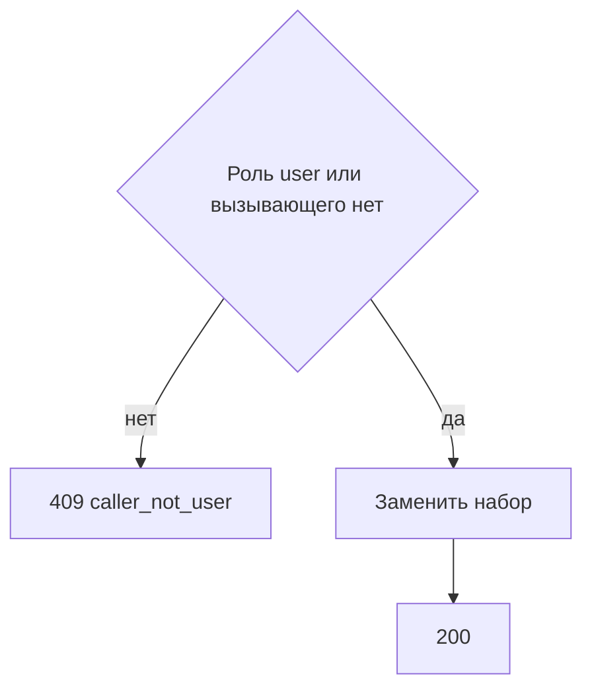

# [На главную](../../../API.md)

# Описание

PUT **/admin/callers/{caller_id}/dictionaries**
Записать набор справочников обычного пользователя. Прежние строки `caller_dictionary` этого `caller_id` заменяются пришедшим списком. Вызывающего с ролью `user` ещё нет — метод создаёт его и записывает набор.

# Входные параметры

+ `X-Caller-Id`:
    + header
    + Обязательно
    + uuid
+ `caller_id`:
    + path
    + Обязательно
    + uuid
+ `dictionary_codes`:
    + body
    + Обязательно
    + Массив кодов. Пустой массив оставляет пользователю пустой набор
    + Каждый код — `^[a-z][a-z0-9_]{0,62}$`
    + Повтор кода в массиве нельзя

# Поля ответа

+ `caller_id`
+ `role` = `user`
+ `dictionary_codes` — записанный список

# Алгоритм работы

## Валидация

1. Прочитать заголовок `X-Caller-Id`: uuid. Нет заголовка или значение не uuid:
    + Код: `invalid_request`
    + Статус: `400`
2. Найти `caller` по этому идентификатору. Строки нет либо роль не `admin`:
    + Код: `forbidden`
    + Статус: `403`
3. Проверить `caller_id` и `dictionary_codes`: uuid, шаблон кода, без повторов.
    + Нарушение:
        + Код: `invalid_request`
        + Статус: `400`
4. Каждый код есть в `dictionary` без учёта регистра.
    + Нет:
        + Код: `dictionary_not_found`
        + Статус: `404`

## Бизнес-логика

1. `caller` с этим `caller_id` есть и роль не `user`:
    + Код: `caller_not_user`
    + Статус: `409`
2. Начать транзакцию. Вызывающего нет — вставить `caller` с ролью `user`. Удалить строки `caller_dictionary` этого `caller_id` и вставить по строке на каждый код. Зафиксировать транзакцию. Вернуть статус `200`.

Коды пишутся в том виде, в каком они лежат в `dictionary.dictionary_code`.
