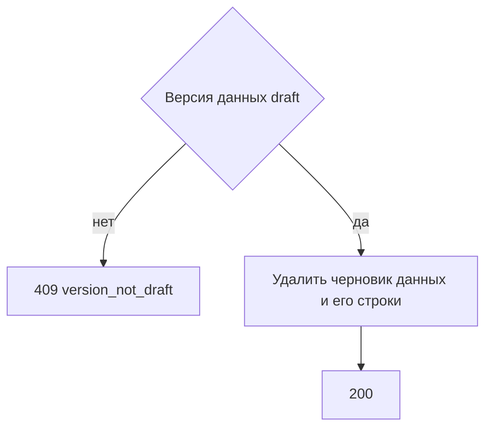

# [На главную](../../../API.md)

# Описание

DELETE **/admin/dictionaries/{dictionary_code}/data-versions/{data_version_id}**
Удалить черновик версии данных и его черновые строки. Схема, активные элементы и опубликованные строки остаются.

# Входные параметры

+ `dictionary_code`:
    + path
    + Обязательно
    + `^[a-z][a-z0-9_]{0,62}$`
+ `data_version_id`:
    + path
    + Обязательно
    + Целое от 1

Тела нет.

# Поля ответа

+ `dictionary_code`
+ `data_version_id`

# Алгоритм работы

## Валидация

1. Проверить путь.
    + Нарушение:
        + Код: `invalid_request`
        + Статус: `400`
2. Найти паспорт по коду без учёта регистра.
    + Нет:
        + Код: `dictionary_not_found`
        + Статус: `404`
3. Найти версию данных с этим `data_version_id`.
    + Нет:
        + Код: `version_not_found`
        + Статус: `404`

## Бизнес-логика

1. Версия данных не `draft`:
    + Код: `version_not_draft`
    + Статус: `409`
2. Удалить строки `dictionary_row` этой версии данных с `status = draft`. Удалить строку `data_version`. Схему и опубликованные строки не менять.
3. Вернуть статус `200`.

Черновик схемы этим методом не удаляется. Если версия данных ссылалась на черновик схемы, схема остаётся.
