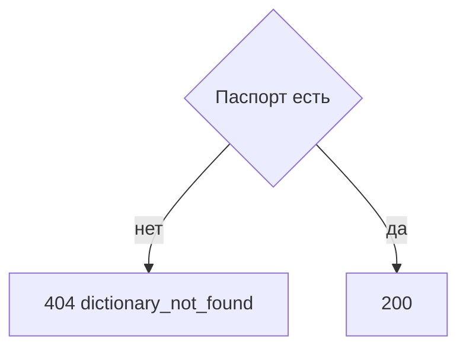

# [На главную](../../../API.md)

# Описание

GET **/admin/dictionaries/{dictionary_code}**
Паспорт, версии схемы и черновик версии данных, если он есть. Состояния значений не возвращаются.

# Входные параметры

+ `X-Caller-Id`:
    + header
    + Обязательно
    + uuid

+ `dictionary_code`:
    + path
    + Обязательно
    + `^[a-z][a-z0-9_]{0,62}$`

Тела нет.

# Поля ответа

+ `dictionary_id`
+ `dictionary_code`
+ `dictionary_name`
+ `owner` — `null`, если не задан
+ `status`
+ `versions`:
    + `scheme_version_id`
    + `status`
    + `valid_from` — пусто у черновика
    + `valid_to` — пусто у черновика и активной
    + `scheme`:
        + `field_id`
        + `code`
        + `name`
        + `type`
        + `dictionary_code` — у колонки `reference`
        + `default` — `true` только у колонки `code = name`
        + `required` — у колонки `code = name` всегда `true`
+ `data_draft` — нет черновика данных, поля нет
    + `data_version_id`
    + `schema_version_id`
    + `type` — `delta` или `full`

# Алгоритм работы

## Валидация

1. Прочитать заголовок `X-Caller-Id`: uuid. Нет заголовка или значение не uuid:
    + Код: `invalid_request`
    + Статус: `400`
2. Найти `caller` по этому идентификатору. Строки нет либо роль не `admin`:
    + Код: `forbidden`
    + Статус: `403`
3. Проверить `dictionary_code`.
    + Нарушение:
        + Код: `invalid_request`
        + Статус: `400`
4. Найти паспорт по коду без учёта регистра.
    + Нет:
        + Код: `dictionary_not_found`
        + Статус: `404`

## Бизнес-логика

1. Вернуть паспорт и все версии, включая `draft` и `closed`. Статус `200`. Деактивированный справочник тоже возвращается. Если есть черновик данных, вернуть его `type`.

Строки значений в ответ не входят.
