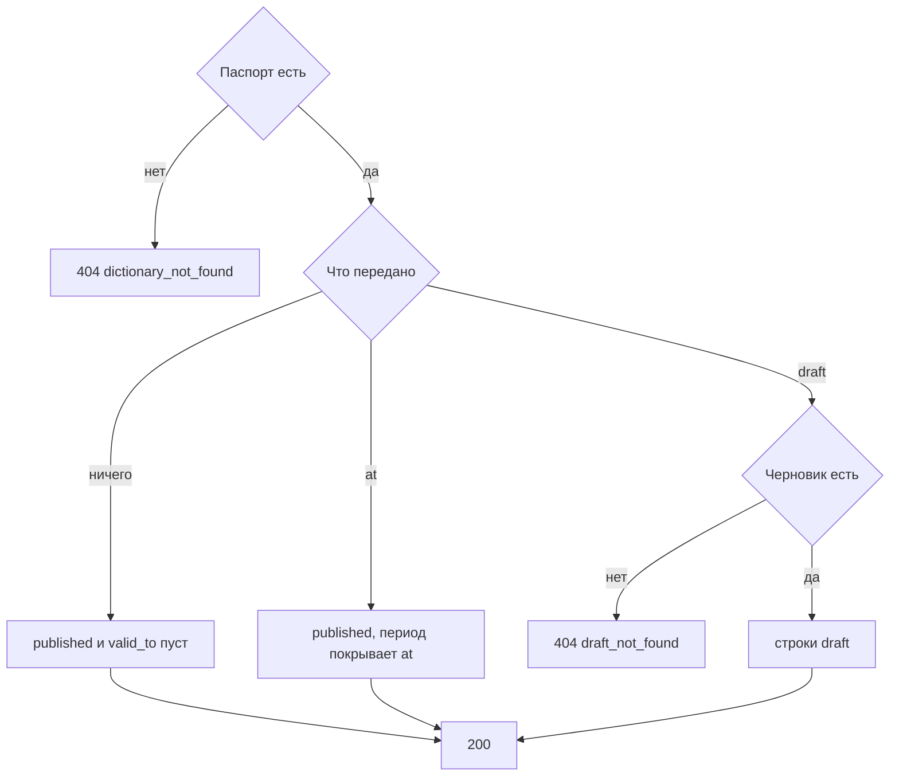

# [На главную](../../../API.md)

# Описание

GET **/admin/dictionaries/{dictionary_code}/rows**
Страница состояний одного справочника: опубликованные открытые, на момент либо черновые.

# Входные параметры

+ `X-Caller-Id`:
    + header
    + Обязательно
    + uuid

+ `dictionary_code`:
    + path
    + Обязательно
    + `^[a-z][a-z0-9_]{0,62}$`
+ `at`:
    + query
    + Не обязательно
    + Момент `YYYY-MM-DDTHH:mm:ssZ`
    + Вместе с `draft` нельзя
+ `draft`:
    + query
    + Не обязательно
    + `true` — строки `status = draft`
    + Нет параметра и нет `at` — опубликованные строки с пустым `valid_to`
+ `value_code`:
    + query
    + Не обязательно
    + До 64 символов `^[A-Za-z0-9_]{1,64}$`
+ `limit`:
    + query
    + Не обязательно
    + Целое от 1 до 1000, по умолчанию 100
+ `cursor`:
    + query
    + Не обязательно
    + Непрозрачная строка предыдущего ответа

# Поля ответа

+ `items`:
    + Массив
    + `value_code`
    + `data_version_id`
    + `schema_version_id`
    + `status`
    + `valid_from`
    + `valid_to` — может быть пустым
    + `data`
+ `next_cursor` — пусто, если страниц больше нет

# Алгоритм работы

## Валидация

1. Прочитать заголовок `X-Caller-Id`: uuid. Нет заголовка или значение не uuid:
    + Код: `invalid_request`
    + Статус: `400`
2. Найти `caller` по этому идентификатору. Строки нет либо роль не `admin`:
    + Код: `forbidden`
    + Статус: `403`
3. Проверить путь, формат `at`, `draft`, `value_code`, `limit` и `cursor`. `draft=true` вместе с `at`:
    + Код: `selector_conflict`
    + Статус: `400`
4. Проверить остальные поля пути и запроса.
    + Нарушение:
        + Код: `invalid_request`
        + Статус: `400`
5. Найти паспорт по коду без учёта регистра.
    + Нет:
        + Код: `dictionary_not_found`
        + Статус: `404`

## Бизнес-логика

1. Выбрать строки секции этого `dictionary_code`.
    + `draft=true` — черновик версии данных и строки `status = draft`. Черновика данных нет, в том числе после публикации:
        + Код: `draft_not_found`
        + Статус: `404`
        + Опубликованные строки в этот ответ не подставляются
    + `at` передан — `status = published`, `valid_from <= at` и (`valid_to` пуст или `valid_to > at`)
    + оба не переданы — `status = published` и `valid_to` пуст
    + `value_code` передан — только этот код
2. Отдать страницу в порядке `value_code`, затем `valid_from`. `next_cursor` пустой, если продолжения нет.
3. Вернуть статус `200`. Деактивированный справочник тоже читается.

Администратор видит `data` как оно хранится. Без `at` и без `draft` это открытые опубликованные строки: `valid_to` пуст, в том числе если `valid_from` ещё не наступил. Запрос с `at` берёт строки, чей период покрывает момент. Пока черновик версии данных есть, его строки читаются тем же методом. Черновик схемы без версии данных строк не добавляет. После публикации запрос с `draft` отвечает так же, как на отсутствующий черновик данных.
