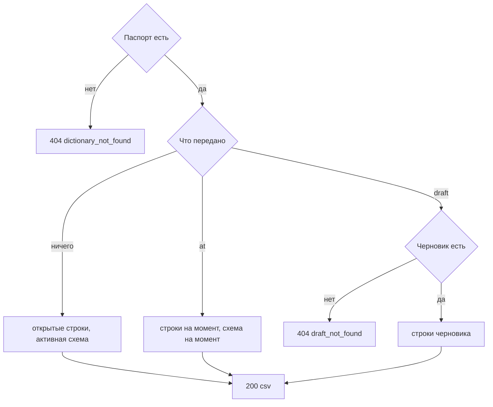

# [На главную](../../../API.md)

# Описание

GET **/admin/dictionaries/{dictionary_code}/rows/csv**
Выгрузить выбранные строки справочника файлом csv. Набор строк тот же, что у [get_rows.md](get_rows.md): открытые, на момент либо черновик. В файл входят все строки этого набора.

# Входные параметры

+ `X-Caller-Id`:
    + header
    + Обязательно
    + uuid

+ `dictionary_code`:
    + path
    + Обязательно
    + `^[a-z][a-z0-9_]{0,62}$`
+ `at`:
    + query
    + Не обязательно
    + Момент `YYYY-MM-DDTHH:mm:ssZ`
    + Вместе с `draft` нельзя
+ `draft`:
    + query
    + Не обязательно
    + `true` — строки `status = draft`
    + Нет параметра и нет `at` — опубликованные строки с пустым `valid_to`
+ `value_code`:
    + query
    + Не обязательно
    + До 64 символов `^[A-Za-z0-9_]{1,64}$`

Тела нет.

# Поля ответа

Тело — файл `text/csv`, UTF-8. Разделитель `;`, кавычки `"`. Первая строка — заголовок.

+ `value_code`
+ колонки схемы выбранного режима, в порядке схемы. Колонка `reference` — одна колонка `{code}`, в ячейке код записи
+ `valid_from` — `YYYY-MM-DDTHH:mm:ssZ`
+ `valid_to` — тот же формат. У открытой строки ячейка пустая

Значение ячейки: `string` — текст, `integer` — целое, `number` — число, `boolean` — `true` или `false`, `reference` — код записи. Пустое необязательное значение — пустая ячейка. В кавычках ячейка, где есть `;`, `"` или перевод строки. Кавычка внутри ячейки удваивается.

# Алгоритм работы

## Валидация

1. Прочитать заголовок `X-Caller-Id`: uuid. Нет заголовка или значение не uuid:
    + Код: `invalid_request`
    + Статус: `400`
2. Найти `caller` по этому идентификатору. Строки нет либо роль не `admin`:
    + Код: `forbidden`
    + Статус: `403`
3. Проверить путь, формат `at`, `draft` и `value_code`. `draft=true` вместе с `at`:
    + Код: `selector_conflict`
    + Статус: `400`
4. Найти паспорт по коду без учёта регистра.
    + Нет:
        + Код: `dictionary_not_found`
        + Статус: `404`

## Бизнес-логика

1. Выбрать строки секции этого `dictionary_code` и схему заголовка.
    + `draft=true` — черновик версии данных и строки `status = draft`. Схема — схема этой версии данных. Черновика данных нет, в том числе после публикации:
        + Код: `draft_not_found`
        + Статус: `404`
    + `at` передан — `status = published`, `valid_from <= at` и (`valid_to` пуст или `valid_to > at`). Схема — опубликованная версия схемы, у которой `valid_from <= at` и (`valid_to` пуст или `valid_to > at`). Такой схемы нет — колонки заголовка берутся из активной схемы
    + оба не переданы — `status = published` и `valid_to` пуст. Схема — активная
    + `value_code` передан — только этот код
    + Активной схемы нет, когда она нужна заголовку:
        + Код: `no_active_version`
        + Статус: `404`
2. Собрать файл. Строки в порядке `value_code`, затем `valid_from`. Значение колонки берётся по `field_id` из `data`, в ячейку пишется под `code` выбранной схемы. Вернуть статус `200`.

Деактивированный справочник тоже выгружается. Файл можно загрузить обратно методом [post_rows_csv.md](post_rows_csv.md): загрузка пишет строки в черновик значений.
