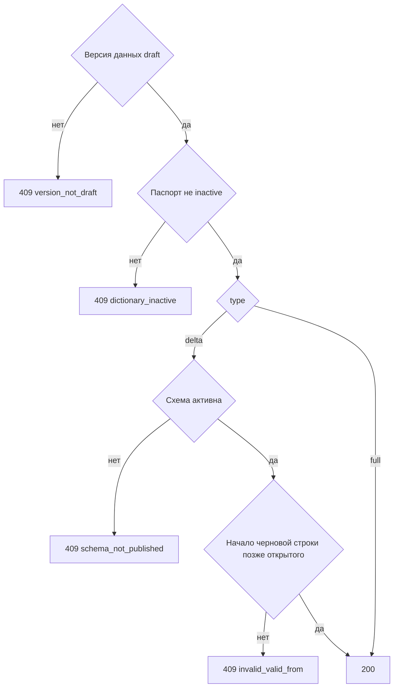

# [На главную](../../../API.md)

# Описание

POST **/admin/dictionaries/{dictionary_code}/data-versions/{data_version_id}/publish/{type}**
Опубликовать черновик версии данных. Схема не закрывается и новая схема не открывается. `type` в пути задаёт публикацию и записывается в версию данных.

`delta` закрывает открытые элементы только тех кодов, что есть в черновике. Черновик, который ссылается на черновик схемы, этим типом не публикуется.

`full` закрывает все ранее открытые строки справочника и открывает строки этой версии. Новая схема для этого не нужна: целиком справочник попадает в черновик загрузкой csv, и эта публикация его открывает.

# Входные параметры

+ `dictionary_code`:
    + path
    + Обязательно
    + `^[a-z][a-z0-9_]{0,62}$`
+ `data_version_id`:
    + path
    + Обязательно
    + uuid
+ `type`:
    + path
    + Обязательно
    + `delta` или `full`

Тела нет.

# Поля ответа

+ `dictionary_code`
+ `data_version_id`
+ `schema_version_id`
+ `status` = `published`
+ `type` — значение из пути
+ `published_at`

# Алгоритм работы

## Валидация

1. Проверить путь. `type` равен `delta` или `full`.
    + Нарушение:
        + Код: `invalid_request`
        + Статус: `400`
2. Найти паспорт по коду без учёта регистра.
    + Нет:
        + Код: `dictionary_not_found`
        + Статус: `404`
3. Найти версию данных с этим `data_version_id`.
    + Нет:
        + Код: `version_not_found`
        + Статус: `404`

## Бизнес-логика

1. Версия данных не `draft`:
    + Код: `version_not_draft`
    + Статус: `409`
2. Паспорт `inactive`:
    + Код: `dictionary_inactive`
    + Статус: `409`
3. `type = delta` и `schema_version_id` не равен активной схеме:
    + Код: `schema_not_published`
    + Статус: `409`
4. Взять момент `T` — время этого запроса.
5. `type = delta`. Для каждой черновой строки найти открытую строку того же `value_code`. Открытая есть и `valid_from` черновой строки не строго позже её `valid_from`:
    + Код: `invalid_valid_from`
    + Статус: `409`
    + Ничего не менять
6. Начать транзакцию.
    + `type = delta` — закрыть открытую строку только у кода, для которого есть черновая строка: `valid_to` = `valid_from` черновой. Черновой строке поставить `status = published`, `valid_to` пуст. Её `valid_from` не менять. Остальные открытые строки не менять
    + `type = full` — каждой ранее открытой строке справочника поставить `valid_to` = `T`. Строкам этой версии поставить `status = published`, `valid_to` пуст. Их `valid_from` не менять
7. Версии данных поставить `type` из пути, `published` и `published_at = T`. Схему не менять. Зафиксировать транзакцию. Вернуть статус `200`.

Схема этим методом не публикуется. `full` закрывает все открытые строки и без новой схемы. Черновик схемы, если он есть, остаётся черновиком.
