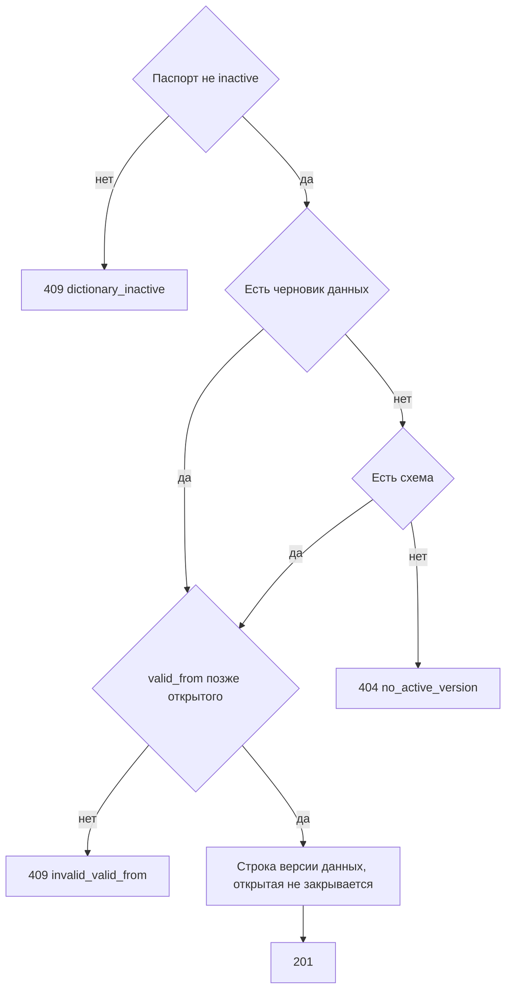

# [На главную](../../../API.md)

# Описание

POST **/admin/dictionaries/{dictionary_code}/rows**
Записать состояние элемента в черновик версии данных. Черновика данных нет — метод его открывает и кладёт в него эту строку. Схему метод не создаёт. Черновик схемы есть — версия данных ссылается на него. Черновика схемы нет — на активную схему, `type = delta`. Опубликованную строку вызов не закрывает. Новое начало строго позже начала открытой строки этого кода, если она есть. Обязательные атрибуты заполнены. Пустое значение допустимо только у необязательного атрибута.

# Входные параметры

+ `dictionary_code`:
    + path
    + Обязательно
    + `^[a-z][a-z0-9_]{0,62}$`
+ `value_code`:
    + body
    + Обязательно
    + `^[A-Za-z0-9_]{1,64}$`
+ `valid_from`:
    + body
    + Обязательно
    + Момент `YYYY-MM-DDTHH:mm:ssZ`
+ `attributes`:
    + body
    + Обязательно
    + Объект
    + Ключи — `code` колонок схемы, на которую ссылается черновик данных. Черновика данных нет и есть черновик схемы — колонки черновика схемы. Иначе колонки активной схемы
    + Колонка с `required = true` передаётся и не пустая
    + Колонка с `required = false` может отсутствовать или быть пустой

# Поля ответа

+ `value_code`
+ `data_version_id`
+ `schema_version_id`
+ `type`
+ `status` = `draft`
+ `valid_from`
+ `valid_to` — пусто
+ `data`

# Алгоритм работы

## Валидация

1. Проверить путь и тело: шаблоны кодов, формат `valid_from`, объект `attributes`.
    + Нарушение:
        + Код: `invalid_request`
        + Статус: `400`
2. Найти паспорт по коду без учёта регистра.
    + Нет:
        + Код: `dictionary_not_found`
        + Статус: `404`
3. Сверить `attributes` с колонками схемы черновика данных. Черновика данных нет — с колонками черновика схемы, а если его нет, с колонками активной схемы. Непустое значение соответствует `type`: `string` — строка до 4000 символов, `integer` — целое число, `number` — число, `boolean` — `true` или `false`.
    + Ключа нет в этих колонках:
        + Код: `unknown_field`
        + Статус: `422`
    + Колонка с `required = true` отсутствует или её значение пустое:
        + Код: `invalid_value`
        + Статус: `422`
    + Непустое значение не совпало с `type`:
        + Код: `invalid_value`
        + Статус: `422`

## Бизнес-логика

1. Паспорт в `inactive`:
    + Код: `dictionary_inactive`
    + Статус: `409`
2. Найти опубликованную открытую строку этого `value_code`.
    + Строка есть и новый `valid_from` не строго позже её `valid_from`:
        + Код: `invalid_valid_from`
        + Статус: `409`
3. Черновика данных нет.
    + Нет ни черновика схемы, ни версии `active`:
        + Код: `no_active_version`
        + Статус: `404`
    + Есть черновик схемы, а активной схемы нет либо состав или обязательность черновика схемы уже отличаются от активной — открыть версию данных: `data_version_id` на 1 больше максимального, `status = draft`, `type = full`, `schema_version_id` черновика схемы, `published_at` пуст
    + Иначе открыть версию данных с `type = delta`. `schema_version_id` — черновик схемы, если он есть, иначе активная схема
4. Начать транзакцию. Удалить прежнюю черновую строку этого `value_code` в этой версии данных, если она есть, и вставить одну: `status = draft`, `data_version_id` черновика, `valid_from` из запроса, `valid_to` пуст, `data` = `attributes`. Опубликованную строку не закрывать. `type` не менять. Зафиксировать транзакцию. Вернуть статус `201`.

Новая строка остаётся в черновике версии данных и не видна запросам без `draft`. Открытую строку и схему этот вызов не закрывает. `delta` хранит только записанные изменения. `full` этой записью не сужается: строка заменяет черновик того же кода. Код внутри атрибута в других строках не ищется.
