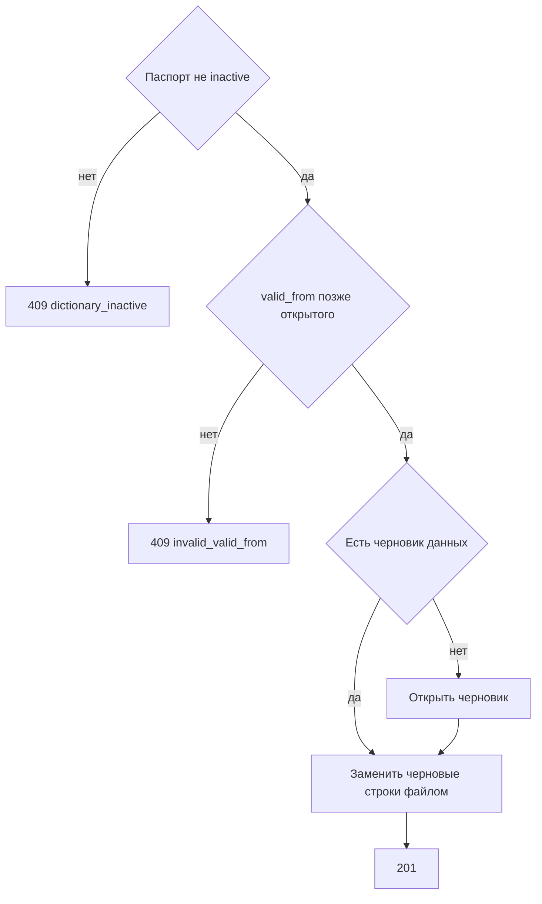

# [На главную](../../../API.md)

# Описание

POST **/admin/dictionaries/{dictionary_code}/rows/csv**
Загрузить файл csv в черновик версии данных. Черновые строки этой версии заменяются строками файла. Схему метод не создаёт. Опубликованную строку вызов не закрывает. Черновика данных нет — метод его открывает по тем же правилам, что [post_row.md](post_row.md).

# Входные параметры

+ `X-Caller-Id`:
    + header
    + Обязательно
    + uuid

+ `dictionary_code`:
    + path
    + Обязательно
    + `^[a-z][a-z0-9_]{0,62}$`
+ `file`:
    + form
    + Обязательно
    + CSV, UTF-8, разделитель `;`, кавычки `"`
    + Первая строка — заголовок
    + Обязательные колонки: `value_code`, `valid_from` и каждая колонка схемы с `required = true`
    + `value_code` — `^[A-Za-z0-9_]{1,64}$`
    + `valid_from` — `YYYY-MM-DDTHH:mm:ssZ`
    + `valid_to` может быть в файле
    + Остальные колонки — `code` колонок схемы. Колонка `reference` — колонка `{code}`, в ячейке код записи справочника из схемы
    + В файле один `value_code` встречается один раз

# Поля ответа

+ `dictionary_code`
+ `data_version_id`
+ `schema_version_id`
+ `type`
+ `row_count` — число записанных строк
+ `status` = `draft`

# Алгоритм работы

## Валидация

1. Прочитать заголовок `X-Caller-Id`: uuid. Нет заголовка или значение не uuid:
    + Код: `invalid_request`
    + Статус: `400`
2. Найти `caller` по этому идентификатору. Строки нет либо роль не `admin`:
    + Код: `forbidden`
    + Статус: `403`
3. Проверить путь и файл: кодировка, разделитель, заголовок, шаблон `value_code`, формат `valid_from`.
    + Нарушение или файл без заголовка:
        + Код: `invalid_request`
        + Статус: `400`
    + В файле повтор `value_code`:
        + Код: `duplicate_value_code`
        + Статус: `422`
4. Найти паспорт по коду без учёта регистра.
    + Нет:
        + Код: `dictionary_not_found`
        + Статус: `404`
5. Сверить заголовок и ячейки со схемой черновика данных. Черновика данных нет — со схемой черновика схемы, а если его нет, со схемой активной версии. Непустое значение соответствует `type`: `string` — строка до 4000 символов, `integer` — целое число, `number` — число, `boolean` — `true` или `false`, `reference` — код записи `^[A-Za-z0-9_]{1,64}$`. Пустая ячейка `reference` — значение пустое.
    + Колонки заголовка нет в схеме и это не `value_code`, `valid_from`, `valid_to`:
        + Код: `unknown_field`
        + Статус: `422`
    + Колонка с `required = true` отсутствует или её значение пустое:
        + Код: `invalid_value`
        + Статус: `422`
    + Непустое значение не совпало с `type`:
        + Код: `invalid_value`
        + Статус: `422`

## Бизнес-логика

1. Паспорт в `inactive`:
    + Код: `dictionary_inactive`
    + Статус: `409`
2. Для каждой строки файла найти опубликованную открытую строку этого `value_code`.
    + Строка есть и `valid_from` из файла не строго позже её `valid_from`:
        + Код: `invalid_valid_from`
        + Статус: `409`
3. Черновика данных нет.
    + Нет ни черновика схемы, ни версии `active`:
        + Код: `no_active_version`
        + Статус: `404`
    + Есть черновик схемы, а активной схемы нет либо состав или обязательность черновика схемы уже отличаются от активной — открыть версию данных: новый `data_version_id`, `status = draft`, `type = full`, `schema_version_id` черновика схемы, `published_at` пуст
    + Иначе открыть версию данных: новый `data_version_id`, `type = delta`. `schema_version_id` — черновик схемы, если он есть, иначе активная схема
4. Начать транзакцию. Удалить черновые строки этой версии данных. Вставить строки файла: `status = draft`, `data_version_id` черновика, `valid_from` из файла, `valid_to` пуст, `data` — атрибуты строки. Зафиксировать транзакцию. Вернуть статус `201`.

Строки файла записываются одной транзакцией. Выгрузка того же черновика — [get_rows_csv.md](get_rows_csv.md).
