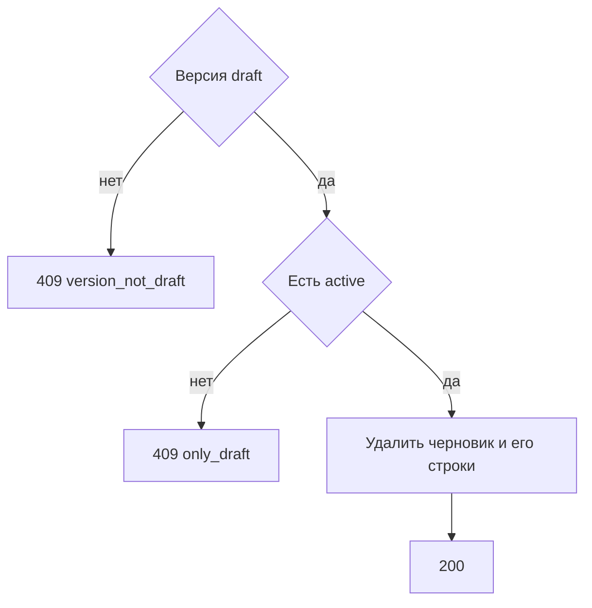

# [На главную](../../../API.md)

# Описание

DELETE **/admin/dictionaries/{dictionary_code}/versions/{scheme_version_id}**
Удалить черновик схемы. Если черновик данных ссылается на него, удалить и эту версию данных с её черновыми строками. Активная схема, опубликованные строки и черновик данных активной схемы остаются. Единственный черновик схемы при отсутствии активной схемы не удаляется.

# Входные параметры

+ `X-Caller-Id`:
    + header
    + Обязательно
    + uuid

+ `dictionary_code`:
    + path
    + Обязательно
    + `^[a-z][a-z0-9_]{0,62}$`
+ `scheme_version_id`:
    + path
    + Обязательно
    + uuid

Тела нет.

# Поля ответа

+ `dictionary_code`
+ `scheme_version_id`

# Алгоритм работы

## Валидация

1. Прочитать заголовок `X-Caller-Id`: uuid. Нет заголовка или значение не uuid:
    + Код: `invalid_request`
    + Статус: `400`
2. Найти `caller` по этому идентификатору. Строки нет либо роль не `admin`:
    + Код: `forbidden`
    + Статус: `403`
3. Проверить путь.
    + Нарушение:
        + Код: `invalid_request`
        + Статус: `400`
4. Найти паспорт по коду без учёта регистра.
    + Нет:
        + Код: `dictionary_not_found`
        + Статус: `404`
5. Найти версию с этим `scheme_version_id`.
    + Нет:
        + Код: `version_not_found`
        + Статус: `404`

## Бизнес-логика

1. Версия не `draft`:
    + Код: `version_not_draft`
    + Статус: `409`
2. Версии `active` нет:
    + Код: `only_draft`
    + Статус: `409`
3. Если черновик данных ссылается на эту схему, удалить его черновые строки и строку `data_version`. Удалить строку `scheme_version`. Опубликованные строки и схему `active` не менять.
4. Вернуть статус `200`.

Закрытые версии этим методом не удаляются. Деактивированный справочник черновик удалить может.
