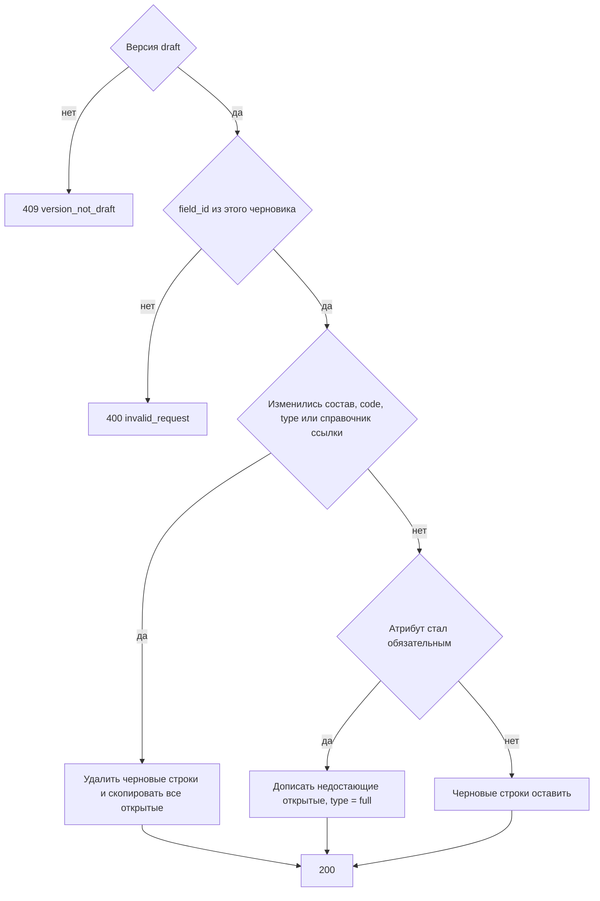

# [На главную](../../../API.md)

# Описание

PATCH **/admin/dictionaries/{dictionary_code}/versions/{scheme_version_id}**
Заменить колонки черновика схемы. Если изменились состав, `code`, `type` колонки или `dictionary_code` колонки `reference`, открывается или переназначается версия данных на этот черновик схемы: прежние черновые строки удаляются, копируются все открытые элементы, `type` версии данных становится `full`. Если атрибут стал обязательным, уже записанные черновые строки остаются, недостающие открытые элементы копируются, `type` версии данных становится `full`. Схему метод не публикует.

# Входные параметры

+ `X-Caller-Id`:
    + header
    + Обязательно
    + uuid

+ `dictionary_code`:
    + path
    + Обязательно
    + `^[a-z][a-z0-9_]{0,62}$`
+ `scheme_version_id`:
    + path
    + Обязательно
    + uuid
+ `scheme`:
    + body
    + Обязательно
    + Желаемый состав, от 1 до 50 колонок
    + Есть колонка `code = name`: `type = string`, `required = true`. Её `default` клиент не передаёт. Колонку нельзя убрать
    + Одинаковые `code` и одинаковые `field_id` нельзя
+ `scheme[].field_id`:
    + Не обязательно
    + Есть — колонка этого черновика. Нет — новая колонка
+ `scheme[].code`:
    + Обязательно
    + `^[a-z][a-z0-9_]{0,62}$`
    + Не `value_code`, `valid_from`, `valid_to`
    + Другой `code` при том же `field_id` — переименование. У колонки `code = name` код не меняется
+ `scheme[].name`:
    + Обязательно
    + От 1 до 200 символов
+ `scheme[].type`:
    + Обязательно
    + `string`, `integer`, `number`, `boolean`, `reference`
    + `reference` — ссылка на элемент справочника. Код справочника задаёт `dictionary_code` этой колонки. В значении строки — код записи
    + У колонки `code = name` только `string`
+ `scheme[].dictionary_code`:
    + Обязательно при `type = reference`
    + `^[a-z][a-z0-9_]{0,62}$`
    + У колонки другого типа этого поля нет
    + Другой `dictionary_code` при том же `field_id` — смена справочника ссылки
+ `scheme[].required`:
    + Обязательно
    + `true` — значение у элемента справочника обязательно
    + `false` — значение можно не передавать или оставить пустым
    + У колонки `code = name` только `true`

# Поля ответа

+ `dictionary_code`
+ `scheme_version_id`
+ `status` = `draft`
+ `rows_cleared` — `true`, если черновые строки этой версии удалены
+ `scheme`:
    + `field_id`
    + `code`
    + `name`
    + `type`
    + `dictionary_code` — у колонки `reference`
    + `default`
    + `required`

# Алгоритм работы

## Валидация

1. Прочитать заголовок `X-Caller-Id`: uuid. Нет заголовка или значение не uuid:
    + Код: `invalid_request`
    + Статус: `400`
2. Найти `caller` по этому идентификатору. Строки нет либо роль не `admin`:
    + Код: `forbidden`
    + Статус: `403`
3. Проверить путь и тело: состав `scheme`, шаблон `code`, запрещённые имена, уникальность `code` и `field_id`, колонка `code = name` с `type = string` и `required = true`, у каждой колонки `required` равен `true` или `false`, у `reference` есть `dictionary_code` по шаблону кода справочника, у остальных типов этого поля нет, не больше 50 колонок, поля `default` нет.
    + Нарушение:
        + Код: `invalid_request`
        + Статус: `400`
4. Найти паспорт по коду без учёта регистра.
    + Нет:
        + Код: `dictionary_not_found`
        + Статус: `404`
5. Найти версию с этим `scheme_version_id`.
    + Нет:
        + Код: `version_not_found`
        + Статус: `404`

## Бизнес-логика

1. Версия не `draft`:
    + Код: `version_not_draft`
    + Статус: `409`
2. Собрать новый список колонок. База для `field_id` — колонки этого черновика.
    + `field_id` не из колонок этого черновика:
        + Код: `invalid_request`
        + Статус: `400`
    + колонка `code = name` без `field_id` или её `field_id` не совпадает с колонкой `name` этого черновика:
        + Код: `invalid_request`
        + Статус: `400`
    + `field_id` нет — новая колонка, назначить `field_id`. Для `code = name` этого шага нет: колонка остаётся со своим `field_id`
    + тот же `field_id` и другой `code` — переименование. Другой `type` — смена типа. Другой `dictionary_code` у `reference` — смена справочника ссылки. `field_id` не пришёл — колонка в черновик не входит. У `name` код и тип не меняются
3. Сравнить новый список с прежним `scheme` черновика по `field_id`, `code`, `type`, `dictionary_code` колонки `reference` и обязательности.
    + Список `field_id`, `code`, `type` или `dictionary_code` колонки `reference` отличается — взять единственный черновик данных или открыть его с новым `data_version_id`. Поставить `schema_version_id` на эту схему и `type` версии данных = `full`. Удалить его черновые строки. Опубликованные строки не трогать. `rows_cleared = true`. Для каждого открытого элемента вставить черновую строку: `data` по `field_id` нового состава, значение переносится, если новый тип его принимает, иначе атрибут пуст. Код записи `reference` остаётся и читается в справочнике новой схемы. `valid_from` черновой строки — `valid_from` открытой
    + Набор, коды и типы колонок те же, но атрибут стал обязательным — тот же черновик данных, `schema_version_id` на эту схему, `type` версии данных = `full`. Уже записанные черновые строки оставить. `rows_cleared = false`. Открытый элемент без черновой строки скопировать так же
    + Состав и обязательность не требуют полного набора — версию данных не открывать и `type` уже открытой версии данных не менять. `rows_cleared = false`. Смена подписи и снятие обязательности полный набор не включают
4. Заменить `scheme` черновика схемы. Колонке `code = name` записать `default = true`, остальным `default = false`. Версию `active` не менять. Вернуть статус `200`.

Активная схема от этой записи не меняется. Публикация полного набора закрывает все ранее открытые строки и открывает строки этой версии. Вместе со схемой — в [post_publish.md](post_publish.md). Отдельно, без новой схемы — в [post_data_publish.md](../DataController/post_data_publish.md), в пути `full`. Смена подписи и снятие обязательности полный набор не включают. Колонка `name` из черновика не убирается. Другая колонка, убранная из черновика, возвращается только как новая, с новым `field_id`. Атрибут по умолчанию — `name`.
