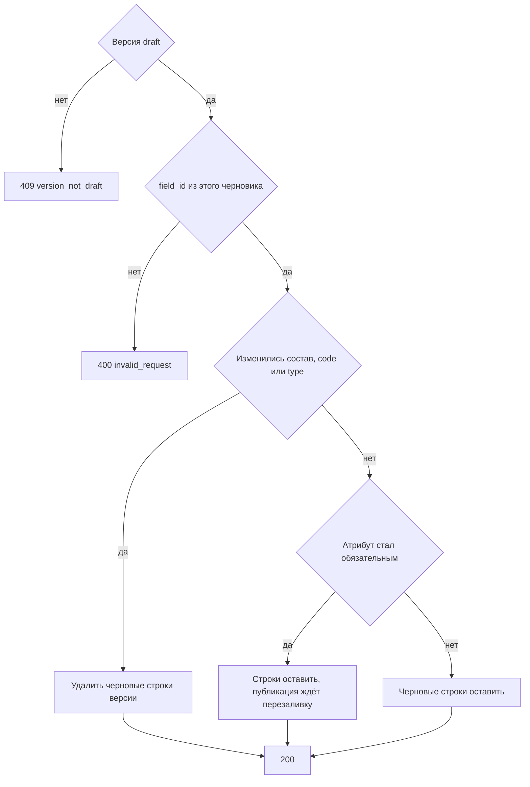

# [На главную](../../../API.md)

# Описание

PATCH **/admin/dictionaries/{dictionary_code}/versions/{version_id}**
Заменить колонки существующего черновика. Если изменились состав, `code` или `type`, черновые строки этой версии удаляются: перед публикацией их нужно записать заново. Если атрибут стал обязательным, строки не удаляются, но без перезаливки черновик не публикуется.

# Входные параметры

+ `dictionary_code`:
    + path
    + Обязательно
    + `^[a-z][a-z0-9_]{0,62}$`
+ `version_id`:
    + path
    + Обязательно
    + Целое от 1
+ `fields`:
    + body
    + Обязательно
    + Желаемый состав, от 1 до 50 колонок
    + Есть колонка `code = name`: `type = string`, `required = true`. Её `default` клиент не передаёт. Колонку нельзя убрать
    + Одинаковые `code` и одинаковые `field_id` нельзя
+ `fields[].field_id`:
    + Не обязательно
    + Есть — колонка этого черновика. Нет — новая колонка
+ `fields[].code`:
    + Обязательно
    + `^[a-z][a-z0-9_]{0,62}$`
    + Не `value_code`, `valid_from`, `valid_to`
    + Другой `code` при том же `field_id` — переименование. У колонки `code = name` код не меняется
+ `fields[].name`:
    + Обязательно
    + От 1 до 200 символов
+ `fields[].type`:
    + Обязательно
    + `string`, `integer`, `number`, `boolean`
    + У колонки `code = name` только `string`
+ `fields[].required`:
    + Обязательно
    + `true` — значение у элемента справочника обязательно
    + `false` — значение можно не передавать или оставить пустым
    + У колонки `code = name` только `true`

# Поля ответа

+ `dictionary_code`
+ `version_id`
+ `status` = `draft`
+ `rows_cleared` — `true`, если черновые строки этой версии удалены
+ `fields`:
    + `field_id`
    + `code`
    + `name`
    + `type`
    + `default`
    + `required`

# Алгоритм работы

## Валидация

1. Проверить путь и тело: состав `fields`, шаблон `code`, запрещённые имена, уникальность `code` и `field_id`, колонка `code = name` с `type = string` и `required = true`, у каждой колонки `required` равен `true` или `false`, не больше 50 колонок, поля `default` нет.
    + Нарушение:
        + Код: `invalid_request`
        + Статус: `400`
2. Найти паспорт по коду без учёта регистра.
    + Нет:
        + Код: `dictionary_not_found`
        + Статус: `404`
3. Найти версию с этим `version_id`.
    + Нет:
        + Код: `version_not_found`
        + Статус: `404`

## Бизнес-логика

1. Версия не `draft`:
    + Код: `version_not_draft`
    + Статус: `409`
2. Собрать новый список колонок. База для `field_id` — колонки этого черновика.
    + `field_id` не из колонок этого черновика:
        + Код: `invalid_request`
        + Статус: `400`
    + колонка `code = name` без `field_id` или её `field_id` не совпадает с колонкой `name` этого черновика:
        + Код: `invalid_request`
        + Статус: `400`
    + `field_id` нет — новая колонка, назначить `field_id`. Для `code = name` этого шага нет: колонка остаётся со своим `field_id`
    + тот же `field_id` и другой `code` — переименование. Другой `type` — смена типа. `field_id` не пришёл — колонка в черновик не входит. У `name` код и тип не меняются
3. Сравнить новый список с прежним `fields` черновика по `field_id`, `code` и `type`.
    + Список отличается — удалить строки `dictionary_row` с этим `version_id` и `row_status = draft`. Опубликованные строки не трогать. `rows_cleared = true`. Без перезаливки черновик не публикуется
    + Набор, коды и типы те же — черновые строки оставить. `rows_cleared = false`. Если какой-либо атрибут стал обязательным, публикация всё равно ждёт перезаливку. Смена подписи и снятие обязательности перезаливку не требуют
4. Заменить `fields` черновика. Колонке `code = name` записать `default = true`, остальным `default = false`. Версию `active` не менять. Вернуть статус `200`.

Активная схема от этой записи не меняется. Если состав атрибутов изменился или атрибут стал обязательным, справочник перезаливается через [post_row.md](../DataController/post_row.md). Без перезаливки [post_publish.md](post_publish.md) черновик не публикует. Смена подписи и снятие обязательности перезаливку не требуют. Колонка `name` из черновика не убирается. Другая колонка, убранная из черновика, возвращается только как новая, с новым `field_id`. Атрибут по умолчанию — `name`.
