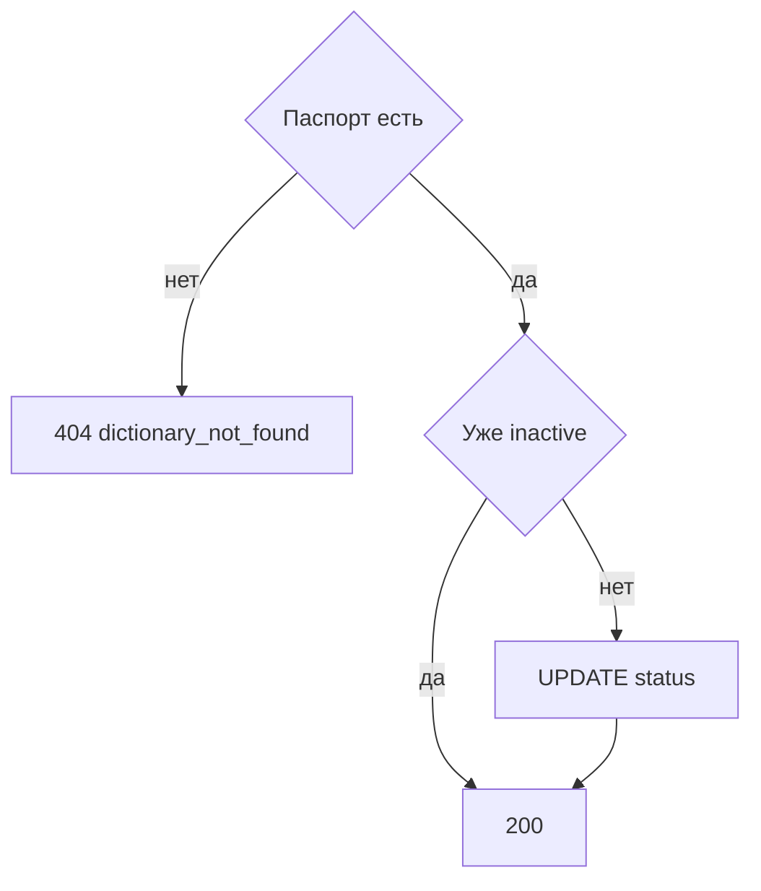

# [На главную](../../../API.md)

# Описание

POST **/admin/dictionaries/{dictionary_code}/deactivate**
Поставить справочнику `inactive`. Строки значений остаются. Повторный вызов ничего не меняет.

# Входные параметры

+ `X-Caller-Id`:
    + header
    + Обязательно
    + uuid

+ `dictionary_code`:
    + path
    + Обязательно
    + `^[a-z][a-z0-9_]{0,62}$`

Тела нет.

# Поля ответа

+ `dictionary_code`
+ `status` = `inactive`

# Алгоритм работы

## Валидация

1. Прочитать заголовок `X-Caller-Id`: uuid. Нет заголовка или значение не uuid:
    + Код: `invalid_request`
    + Статус: `400`
2. Найти `caller` по этому идентификатору. Строки нет либо роль не `admin`:
    + Код: `forbidden`
    + Статус: `403`
3. Проверить `dictionary_code`.
    + Нарушение:
        + Код: `invalid_request`
        + Статус: `400`
4. Найти паспорт по коду без учёта регистра.
    + Нет:
        + Код: `dictionary_not_found`
        + Статус: `404`

## Бизнес-логика

1. Если `status = inactive`, вернуть статус `200`.
2. Иначе записать `inactive`. Строки `dictionary_row` не трогать.
3. Вернуть статус `200`.

Пользовательский каталог деактивированный справочник больше не показывает. Запись новых состояний этим вызовом не запрещается внутри него самого: её отклоняет запись состояния.
