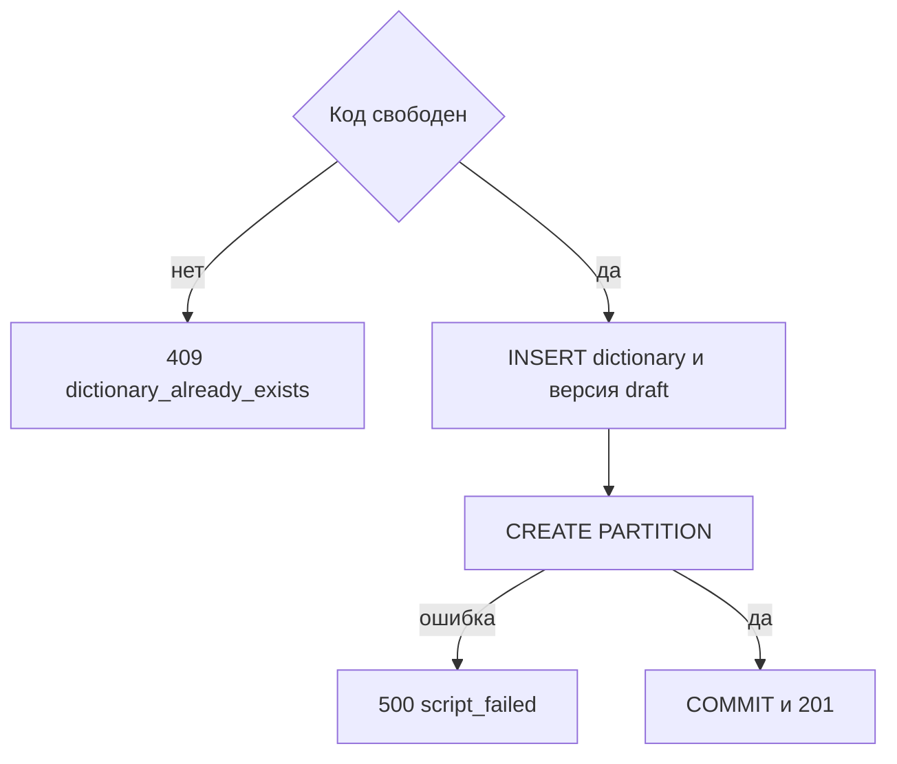

# [На главную](../../../API.md)

# Описание

POST **/admin/dictionaries**
Создать паспорт, пустую секцию и черновик схемы. Это черновик метаданных нового справочника. Активной версии нет. Строки значений не создаются.

# Входные параметры

+ `X-Caller-Id`:
    + header
    + Обязательно
    + uuid

+ `dictionary_code`:
    + body
    + Обязательно
    + `^[a-z][a-z0-9_]{0,62}$`
    + Уникален без учёта регистра
    + После создания не меняется
+ `dictionary_name`:
    + body
    + Обязательно
    + От 1 до 200 символов
+ `owner`:
    + body
    + Не обязательно
    + До 200 символов
    + Не передан — в паспорте `NULL`
+ `scheme`:
    + body
    + Обязательно
    + От 1 до 50 колонок
    + Ровно одна колонка с `code = name`: `type = string`, `required = true`. Это атрибут по умолчанию, клиент его не назначает
    + Одинаковые `code` нельзя
+ `scheme[].code`:
    + Обязательно
    + `^[a-z][a-z0-9_]{0,62}$`
    + Не `value_code`, `valid_from`, `valid_to`
+ `scheme[].name`:
    + Обязательно
    + От 1 до 200 символов
+ `scheme[].type`:
    + Обязательно
    + `string`, `integer`, `number`, `boolean`, `reference`
    + `reference` — ссылка на элемент справочника. Код справочника задаёт `dictionary_code` этой колонки. В значении строки — код записи
    + У колонки `code = name` только `string`
+ `scheme[].dictionary_code`:
    + Обязательно при `type = reference`
    + `^[a-z][a-z0-9_]{0,62}$`
    + У колонки другого типа этого поля нет
+ `scheme[].required`:
    + Обязательно
    + `true` — у элемента справочника значение этой колонки должно быть заполнено
    + `false` — значение можно не передавать или передать пустым
    + У колонки `code = name` только `true`

# Поля ответа

+ `dictionary_id`
+ `dictionary_code`
+ `dictionary_name`
+ `owner`
+ `status` = `active`
+ `scheme_version_id`
+ `version_status` = `draft`
+ `scheme` — с назначенными `field_id`. У колонки `code = name` в ответе `default = true`, у остальных `false`

# Алгоритм работы

## Валидация

1. Прочитать заголовок `X-Caller-Id`: uuid. Нет заголовка или значение не uuid:
    + Код: `invalid_request`
    + Статус: `400`
2. Найти `caller` по этому идентификатору. Строки нет либо роль не `admin`:
    + Код: `forbidden`
    + Статус: `403`
3. Проверить тело: шаблон `dictionary_code`, длины, состав `scheme`, шаблон `code`, запрещённые имена, уникальность `code`, ровно одна колонка `code = name` с `type = string` и `required = true`, у каждой колонки `required` равен `true` или `false`, у `reference` есть `dictionary_code` по шаблону кода справочника, у остальных типов этого поля нет, не больше 50 колонок, неизвестных полей нет. Поля `default` во входе нет.
    + Нарушение:
        + Код: `invalid_request`
        + Статус: `400`

## Бизнес-логика

1. Проверить уникальность `dictionary_code` без учёта регистра.
    + Код занят:
        + Код: `dictionary_already_exists`
        + Статус: `409`
2. Начать транзакцию.
3. Вставить строку в `dictionary`: новый `dictionary_id`, `status = active`.
4. Вставить `scheme_version`: новый `scheme_version_id`, `status = draft`, `valid_from` и `valid_to` пустые. Каждой колонке назначить `field_id`. Колонке `code = name` записать `default = true`, остальным `default = false`. Версию данных не создавать.
5. Создать секцию `dictionary_row_{dictionary_code}` для `FOR VALUES IN (dictionary_code)`.
    + Ошибка выполнения:
        + Код: `script_failed`
        + Статус: `500`
        + Транзакция откатывается
6. Зафиксировать транзакцию. Вернуть статус `201`.

Секция создаётся пустой. Колонки описаны в первом черновике и ещё не действуют для запросов без `draft`. Следующий черновик после публикации открывается в [post_version.md](post_version.md). Активной схема становится через [post_publish.md](post_publish.md).
