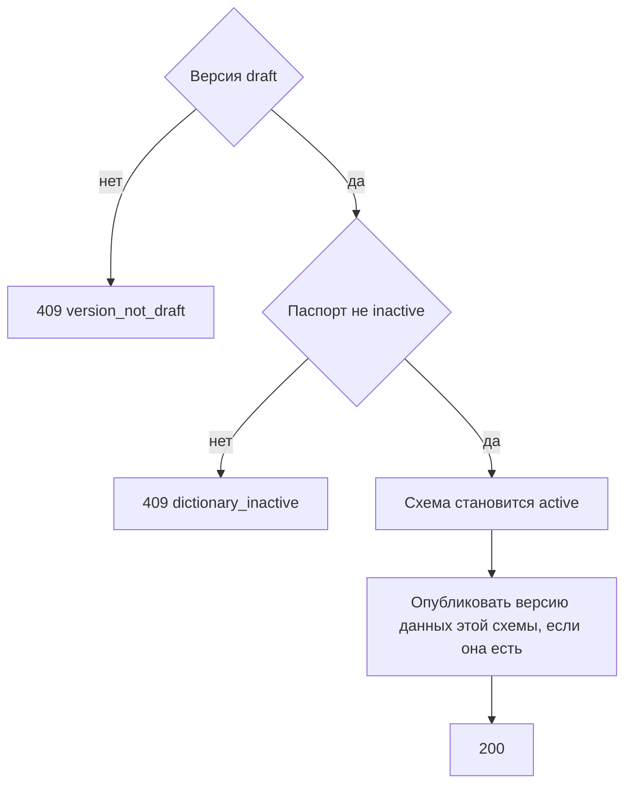

# [На главную](../../../API.md)

# Описание

POST **/admin/dictionaries/{dictionary_code}/versions/{scheme_version_id}/publish**
Перевести черновик схемы в активную версию. Прежняя активная схема закрывается. Версию данных, которая ссылается на активную схему, метод не публикует. Версию данных, которая ссылается на этот черновик схемы, публикует в той же транзакции. `delta` закрывает только свои коды. `full` закрывает все ранее открытые строки справочника и открывает строки этой версии. Полный набор без новой схемы публикуется в [post_data_publish.md](../DataController/post_data_publish.md).

# Входные параметры

+ `X-Caller-Id`:
    + header
    + Обязательно
    + uuid

+ `dictionary_code`:
    + path
    + Обязательно
    + `^[a-z][a-z0-9_]{0,62}$`
+ `scheme_version_id`:
    + path
    + Обязательно
    + uuid

Тела нет.

# Поля ответа

+ `dictionary_code`
+ `scheme_version_id`
+ `status` = `active`
+ `valid_from`
+ `valid_to` — пусто

# Алгоритм работы

## Валидация

1. Прочитать заголовок `X-Caller-Id`: uuid. Нет заголовка или значение не uuid:
    + Код: `invalid_request`
    + Статус: `400`
2. Найти `caller` по этому идентификатору. Строки нет либо роль не `admin`:
    + Код: `forbidden`
    + Статус: `403`
3. Проверить путь.
    + Нарушение:
        + Код: `invalid_request`
        + Статус: `400`
4. Найти паспорт по коду без учёта регистра.
    + Нет:
        + Код: `dictionary_not_found`
        + Статус: `404`
5. Найти версию с этим `scheme_version_id`.
    + Нет:
        + Код: `version_not_found`
        + Статус: `404`

## Бизнес-логика

1. Версия не `draft`:
    + Код: `version_not_draft`
    + Статус: `409`
2. Паспорт `inactive`:
    + Код: `dictionary_inactive`
    + Статус: `409`
3. Взять момент `T` — время этого запроса.
4. Для черновика данных, который ссылается на эту схему и имеет `type = delta`, проверить строки. У кода есть открытая строка и `valid_from` черновой строки не строго позже её `valid_from`:
    + Код: `invalid_valid_from`
    + Статус: `409`
    + Ничего не менять
5. Начать транзакцию.
6. Если есть схема `active`, поставить ей `closed` и `valid_to = T`.
7. Черновику схемы поставить `active` и `valid_from = T`. `valid_to` оставить пустым.
8. Если черновик данных ссылается на эту схему, опубликовать его строки и поставить версии данных `published`, `published_at = T`.
    + `type = delta` — закрыть открытую строку только у кода, для которого есть черновая строка. `valid_to` открытой = `valid_from` черновой. Черновой строке поставить `status = published`, `valid_to` пуст. Её `valid_from` не менять
    + `type = full` — каждой ранее открытой строке справочника поставить `valid_to` = `T`. Строкам этой версии поставить `status = published`, `valid_to` пуст. Их `valid_from` не менять
9. Черновик данных, который ссылается на прежнюю активную схему, не менять. Зафиксировать транзакцию. Вернуть статус `200`.

Смена подписи или снятие обязательности не открывает версию данных. Установка обязательности открывает `full`. Атрибут по умолчанию — колонка `name`. После публикации запрос черновика схемы отвечает так же, как на отсутствующую версию. Начало схемы — `T`. Версия данных, которая ссылается на активную схему, публикуется отдельно в [post_data_publish.md](../DataController/post_data_publish.md): `full` в пути закрывает все открытые строки и схему не меняет.
