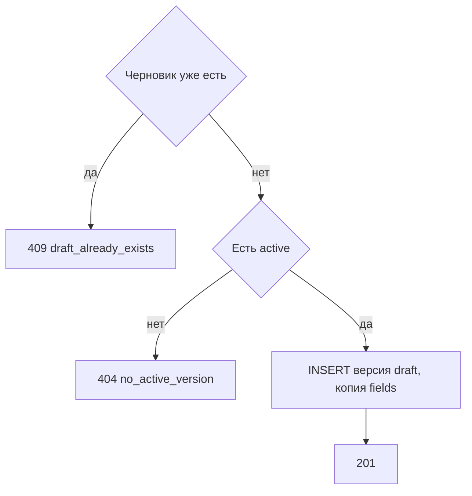

# [На главную](../../../API.md)

# Описание

POST **/admin/dictionaries/{dictionary_code}/versions**
Открыть следующую версию со статусом `draft`, чтобы менять атрибуты действующего справочника. Колонки копируются из активной версии. Для записи значений элементов этот метод не используется. Если черновик уже есть, второй не создаётся.

# Входные параметры

+ `dictionary_code`:
    + path
    + Обязательно
    + `^[a-z][a-z0-9_]{0,62}$`

Тела нет.

# Поля ответа

+ `dictionary_code`
+ `version_id`
+ `status` = `draft`
+ `valid_from` — пусто
+ `valid_to` — пусто
+ `fields` — копия колонок активной версии:
    + `field_id`
    + `code`
    + `name`
    + `type`
    + `default`
    + `required`

# Алгоритм работы

## Валидация

1. Проверить путь.
    + Нарушение:
        + Код: `invalid_request`
        + Статус: `400`
2. Найти паспорт по коду без учёта регистра.
    + Нет:
        + Код: `dictionary_not_found`
        + Статус: `404`

## Бизнес-логика

1. Версия `draft` уже есть:
    + Код: `draft_already_exists`
    + Статус: `409`
2. Версии `active` нет:
    + Код: `no_active_version`
    + Статус: `404`
3. Вставить следующую версию: `version_id` на 1 больше максимального, `status = draft`, `valid_from` и `valid_to` пустые, `fields` — те же колонки, что у активной версии, с теми же `field_id`. Строки `dictionary_row` не создавать.
4. Вернуть статус `201`.

Первый черновик справочника создаёт [post_dictionaries.md](post_dictionaries.md), а не этот метод. Колонки черновика меняются в [patch_version.md](patch_version.md). Копия содержит колонку `name`: `type = string`, `required = true`, `default = true`. Активная версия и опубликованные строки остаются. Пока черновик открыт, запись состояний идёт в него и эти строки не закрывает. Деактивированный справочник черновик открыть может.
