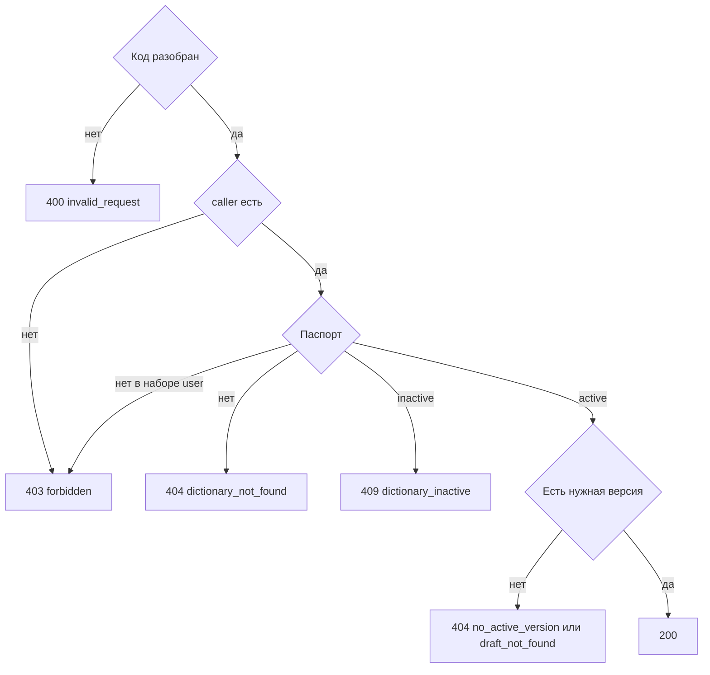

# [На главную](../../../API.md)

# Описание

GET **/dictionaries/{dictionary_code}/columns**
Названия и типы колонок. Без `draft` это активная версия. С `draft=true` — черновик. После публикации черновика ответ тот же, что на отсутствующую версию. По этим `code` клиент собирает параметр `attribute`, в том числе для чтения значения на выбранный момент: колонка находится по `field_id`, даже если в старой строке у неё другой `code`.

# Входные параметры

+ `X-Caller-Id`:
    + header
    + Обязательно
    + uuid
+ `dictionary_code`:
    + path
    + Обязательно
    + `^[a-z][a-z0-9_]{0,62}$`
+ `draft`:
    + query
    + Не обязательно
    + `true` — колонки черновика

Тела нет.

# Поля ответа

+ `dictionary_code`
+ `columns`:
    + Массив в порядке паспорта
    + `code`
    + `name`
    + `type`
    + `dictionary_code` — у колонки `reference`, код справочника ссылки
    + `default` — `true` только у колонки `code = name`
    + `required` — `true`, если значение этой колонки у элемента обязательно. У `name` всегда `true`

# Алгоритм работы

1. Прочитать заголовок `X-Caller-Id`: uuid. Нет заголовка или значение не uuid:
    + Код: `invalid_request`
    + Статус: `400`
2. Найти `caller` по этому идентификатору. Строки нет:
    + Код: `forbidden`
    + Статус: `403`
3. Проверить `dictionary_code`.
    + Нарушение:
        + Код: `invalid_request`
        + Статус: `400`
4. Найти паспорт по коду без учёта регистра.
    + Нет:
        + Код: `dictionary_not_found`
        + Статус: `404`
    + Роль `user` и `dictionary_code` нет в `caller_dictionary` этого `caller_id`:
        + Код: `forbidden`
        + Статус: `403`
    + `status = inactive`:
        + Код: `dictionary_inactive`
        + Статус: `409`
5. Выбрать версию.
    + `draft=true` — версия `draft`. Её нет, в том числе после публикации:
        + Код: `draft_not_found`
        + Статус: `404`
        + Колонки активной версии в этот ответ не подставляются
    + иначе версия `active`. Её нет:
        + Код: `no_active_version`
        + Статус: `404`
6. Из `scheme` этой версии вернуть колонки как `columns`, без `field_id`. Статус `200`.

Метод не читает `dictionary_row` и не показывает, какие ключи уже лежат в `data`.
