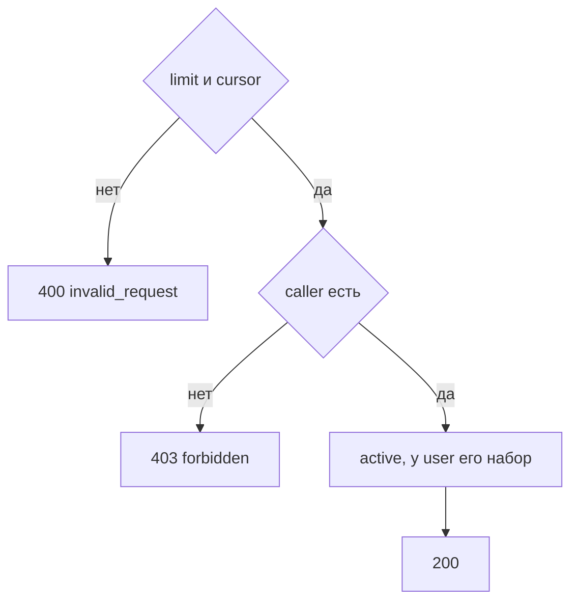

# [На главную](../../../API.md)

# Описание

GET **/dictionaries**
Страница справочников, у которых есть активная версия и паспорт не деактивирован. Черновик без активной версии в перечень не входит.

# Входные параметры

+ `X-Caller-Id`:
    + header
    + Обязательно
    + uuid
+ `limit`:
    + query
    + Не обязательно
    + Целое от 1 до 1000, по умолчанию 100
+ `cursor`:
    + query
    + Не обязательно
    + Непрозрачная строка предыдущего ответа

# Поля ответа

+ `items`:
    + Массив
    + `dictionary_code`
    + `dictionary_name`
+ `next_cursor` — пусто, если страниц больше нет

# Алгоритм работы

1. Прочитать заголовок `X-Caller-Id`: uuid. Нет заголовка или значение не uuid:
    + Код: `invalid_request`
    + Статус: `400`
2. Найти `caller` по этому идентификатору. Строки нет:
    + Код: `forbidden`
    + Статус: `403`
3. Проверить `limit` и `cursor`.
    + Нарушение:
        + Код: `invalid_request`
        + Статус: `400`
4. Прочитать страницу `dictionary` со `status = active` и с версией `active`, в порядке `dictionary_code`, после курсора. Роль `user` оставляет коды из `caller_dictionary` этого `caller_id`. Роль `admin` или `system` отдаёт страницу без этого отбора.
5. Вернуть статус `200`. Если продолжения нет, `next_cursor` пустой.

Деактивированные паспорта в эту страницу не входят. Состав колонок запрашивается отдельно по коду.
