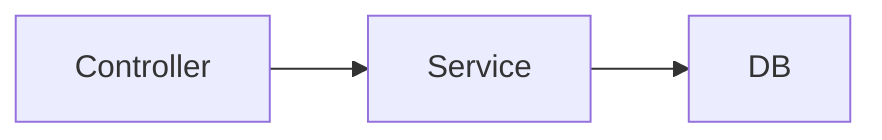

# Модуль справочников: сервис чтения

Сервис выполняет три операции чтения простого списка: одно значение, страница редакции, проверка ссылок.

## 1. Слои

Вызов идёт сверху вниз.

| Слой | Ответственность |
|---|---|
| Controller | Принимает HTTP, проверяет форму запроса, возвращает JSON и код ответа |
| Service | Выбирает редакцию, читает строки из памяти или через DB, собирает `present`, `absent` или `archived` |
| DB | Читает паспорт и версии из каталога и строки одной секции по `version_id` |
### Controller

Принимает три маршрута и переводит их в вызов Service. Из запроса достаёт код справочника, код значения, признак редакции, `limit`, курсор и список кодов проверки.

| Операция | Маршрут |
|---|---|
| Одно значение | `GET /dictionaries/{dictionary_code}/values/{value_code}` |
| Страница | `GET /dictionaries/{dictionary_code}/values` |
| Проверка ссылок | `POST /dictionaries/{dictionary_code}/values/check` |

Форму запроса проверяет сам. Два признака редакции сразу — `version_selector_conflict`. Пустая проверка, больше 1000 кодов, `limit` вне 1…1000 и неразборчивый курсор — `invalid_request`.

Ответ Service отдаёт телом контракта. `present`, `absent` и `archived` возвращает с кодом 200. Ошибку отсутствующей редакции — с кодом 404.

| `error` | HTTP |
|---|---|
| `version_selector_conflict`, `invalid_request` | 400 |
| `dictionary_not_found`, `version_not_found`, `version_not_published`, `no_active_version`, `date_out_of_range` | 404 |
### Service

Собирает ответ контракта по одному справочнику.

Редакцию выбирает по каталогу в памяти. В ответ кладёт тот `version_id`, который выбрал.

| Что передано | Какая редакция |
|---|---|
| ничего | Версия в статусе `active`. Если её нет — `no_active_version` |
| `on_date` | Версия, в чей период день попадает включительно. Пустой `valid_to` — открытый конец. Нет такого периода — `date_out_of_range` |
| `version_id` | Эта строка каталога. Нет строки — `version_not_found`. Статус `draft` — `version_not_published` |

Периоды опубликованных версий одного справочника не пересекаются. Если день попал в два периода, Service завершает запрос ошибкой чтения каталога.

Дальше смотрит признак секции.
- Секция отсоединена. Одно значение получает `result = archived` и пустую подпись. Страница получает `archived: true` и пустой `items`. Проверка получает `archived: true` и по каждому переданному коду `result = archived`.
- Секция на месте и версия есть в памяти. Код ищется в карте `value_code → name`. Страница берётся из этой карты по порядку `value_code`.
- Секция на месте и карты нет. Service вызывает DB. Один код и список проверки читаются по `version_id` и кодам. Страница читается по `version_id`, порядку `value_code` и границе курсора.

Найденный код получает `result = present` и подпись. Код, которого в секции нет, получает `result = absent` и пустую подпись.

Курсор несёт `version_id` выбранной редакции и последний `value_code` страницы. Следующий запрос передаёт тот же признак редакции. Если он разрешается в другой `version_id`, Service возвращает `invalid_request`.

Повтор одного кода в проверке сворачивается в одну строку ответа до чтения секции.

### DB

Отдаёт Service два набора строк.
Каталог по `dictionary_code`: паспорт и версии со статусом `active` и `closed`. У версии — `version_id`, статус, `valid_from`, `valid_to`, `table_name` и признак, что секция присоединена.
Секция — таблица из `table_name`, всегда с условием `version_id`:

- строка по `version_id` и `value_code`;
- строки по `version_id` и списку кодов;
- страница: `value_code` больше границы курсора, порядок по `value_code`, не больше `limit`;
- число строк секции — чтобы Service решил, собирать ли карту версии.

## 2. Кэш

Кэш держит Service в памяти процесса. У каждого экземпляра свой каталог и свои карты версий.

| Запись | Ключ | Содержимое |
|---|---|---|
| Каталог | один на процесс | По каждому `dictionary_code`: статус паспорта и опубликованные версии с периодами и признаком секции |
| Версия | `dictionary_code` + `version_id` | Карта `value_code → name` целиком |

В каталоге кэша лежат версии `active` и `closed`. Карта действующей версии собирается при прогреве. Карта закрытой версии собирается при первом чтении по `version_id` или по дате, если строк не больше порога. Пока карты нет, Service читает секцию через DB.
Запись версии хранится, пока секция присоединена. Параллельные чтения одной версии в одном процессе ждут одну загрузку.
Порог числа строк — настройка сервиса, исходное значение 10 000. Версия тяжелее порога при каждом запросе читается из секции.

## 3. Инвалидация

Service обновляет память по событиям каталога. Событие архива пишется в той же транзакции, что и отсоединение секции.

| Событие | Что приходит | Что делает экземпляр |
|---|---|---|
| Публикация | Код справочника, новый `version_id`, `valid_from`, номер прежней действующей версии | Заново читает каталог этого справочника и прогревает новую действующую версию в пределах порога. Прежняя версия остаётся в памяти |
| Архив | Код справочника и `version_id` | Помечает секцию отсоединённой и удаляет карту этой версии |

У каждого экземпляра своя группа потребителя, поэтому публикацию и архив получают все. Домены и представления читают те же события своими группами.
Периодически экземпляр перечитывает каталог из базы. Пока секция присоединена, карта версии при этом остаётся. Отсоединённая секция удаляет свою карту. Так в память попадает пропущенное событие.

## 4. Прогрев

Прогрев заполняет кэш Service.

При старте экземпляра:

1. Прочитать паспорта и опубликованные версии всех справочников.
2. Для каждой действующей версии простого списка узнать число строк секции.
3. Если строк не больше порога — прочитать секцию и собрать карту `value_code → name`.

Экземпляр принимает запросы, когда каталог загружен. Карты действующих версий собираются следом. До сборки карты версия читается из секции.
Сбой одного списка оставляет его на чтении из секции. Остальные списки прогреваются своим чередом. Следующий проход каталога собирает карту этого списка снова.
При старте в карты попадают действующие версии в пределах порога. Закрытая версия попадает в карту при первом чтении, тем же порогом. После публикации новый `version_id` прогревается тем же правилом, без перезапуска процесса.
