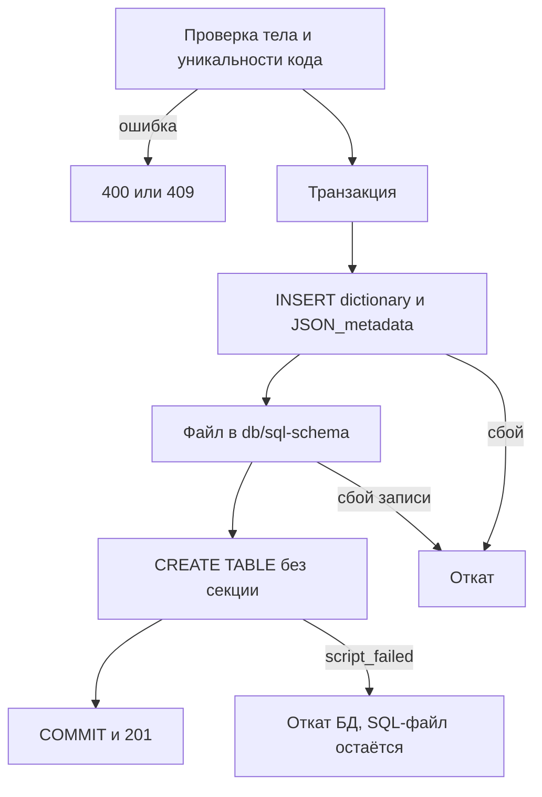
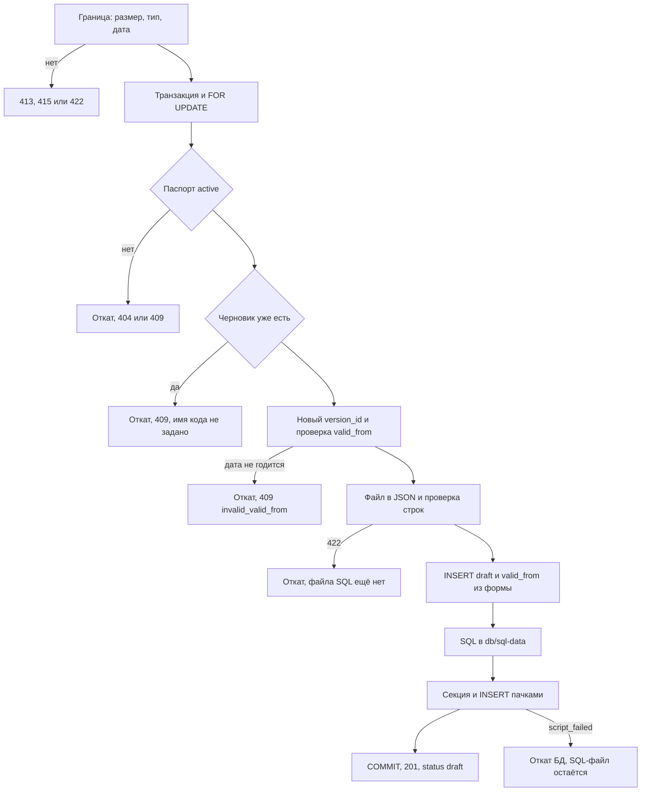
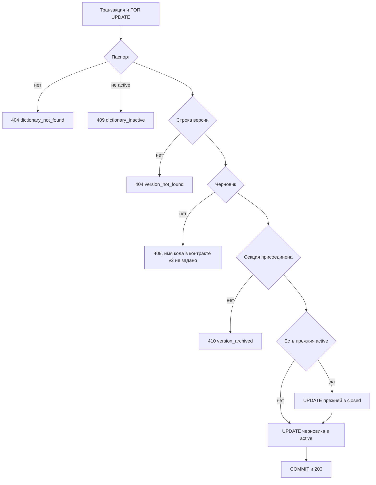
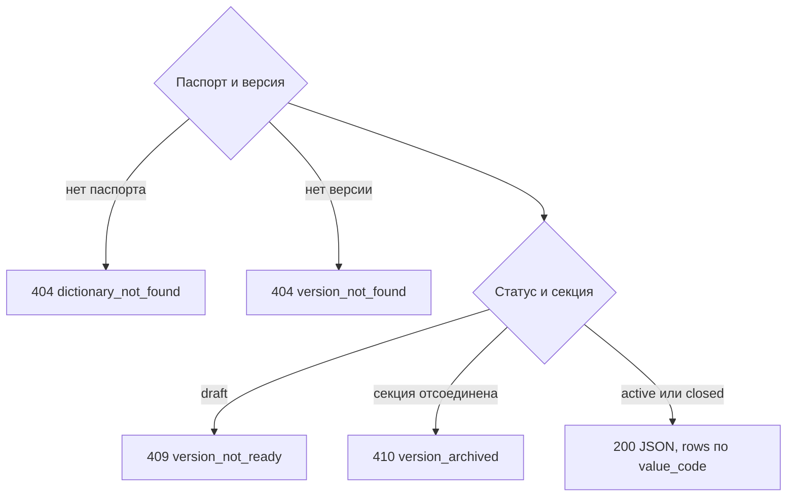
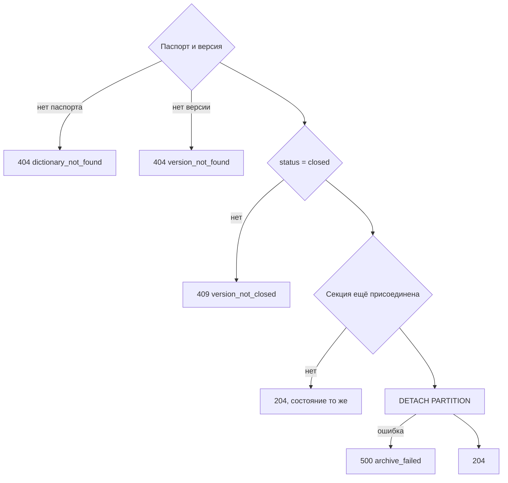
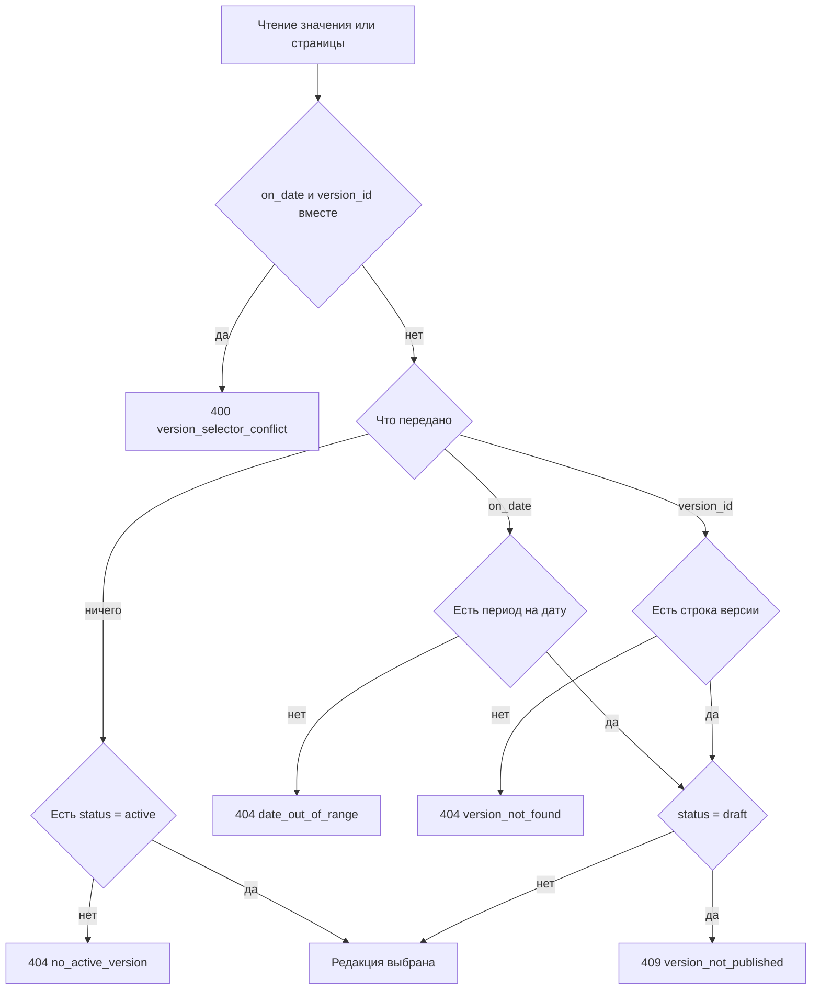
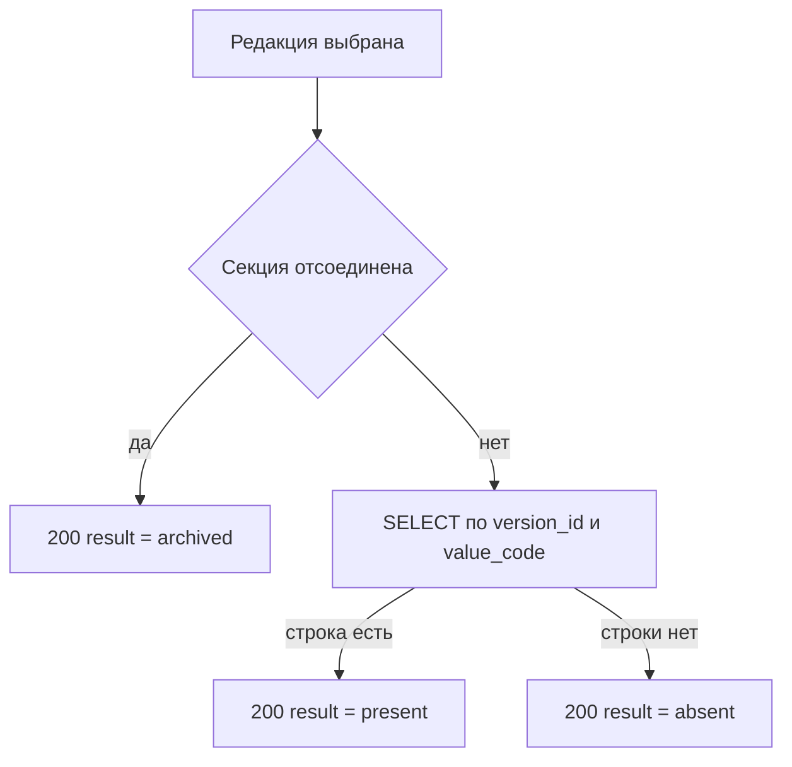
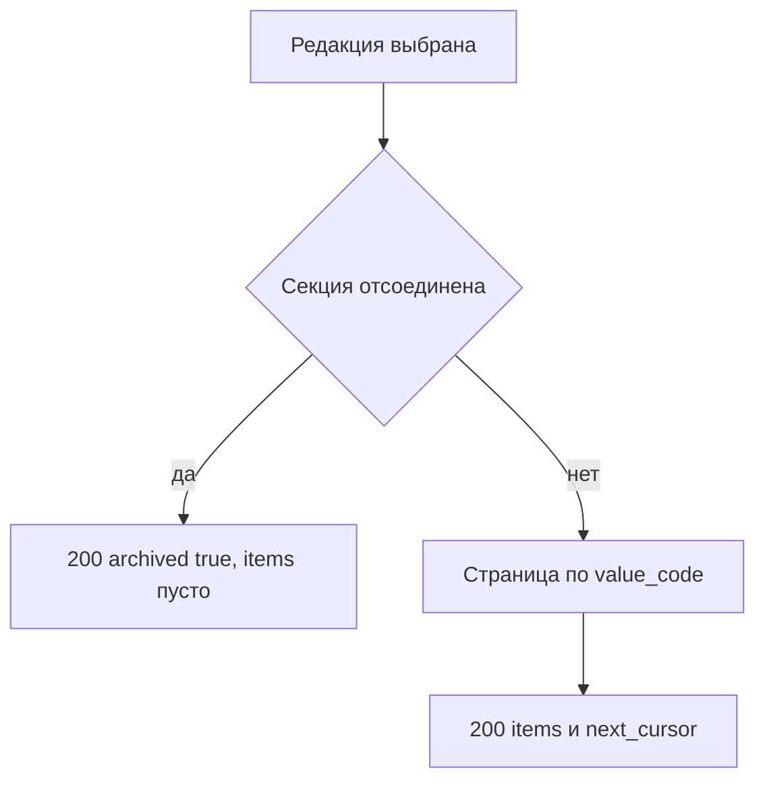
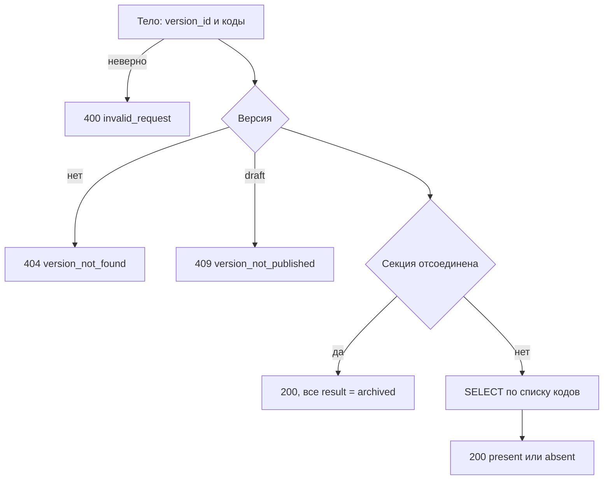

# Спецификация API справочников

Спецификация внешних HTTP-методов справочников: десять методов. Состав методов, поля и коды ошибок взяты из контрактов v2 (`docs/1. functional/v2/1. Контракты API.md`); шаги сверены с документом БД v2 и схемой `Справочники 2.drawio`. Административный контур — `management.api`, в use-case `http://localhost:8080`, префикс `/admin/...`. Чтение — `service.api`, в use-case `http://localhost:8082`, префикс `/dictionaries/...`. Порт `import.api` в контрактах v2 и use-case не задан; публичного API импорта в контракте v2 нет, загрузка файла входит в административный контур. Загрузка файла и публикация версии в v3 — два метода. Контракт v2 публикует версию внутри загрузки. UI v2 и эта спецификация оставляют после загрузки черновик.

Каталог — таблицы `dictionary` и `dictionary_version`. При старте `management.api` их создаёт пустыми скрипт `db/sql-init/001_schema.sql` (use-case). Колонки и ограничения в алгоритмах ниже — по документу БД v2: в текущем `001_schema.sql` нет `JSON_metadata`, а `owner` и `source` объявлены `NOT NULL`. Строки значений лежат в отдельной таблице справочника, не в каталоге. Первичный ключ строки данных — `(version_id, value_code)`. Суррогат вида `wall_material_id` документ БД v2 не использует; на схеме drawio у `simple_dictionary_table` в ключе тоже `version_id` и `value_code`.

# Список методов

Десять методов: семь в `management.api` (три в MetadataController, четыре в DataController) и три в `service.api`.

## management.api

### MetadataController.cs

Паспорт, описание полей и SQL создания таблицы. В коде сейчас есть список, паспорт и `POST /admin/metadata`; метод создания из контракта v2 ложится сюда по префиксу `/admin` и роли каталога.

| Вызов | Назначение | Раздел |
|---|---|---|
| `GET /admin/dictionaries` | Страница паспортов | [Список справочников](#m-list) |
| `GET /admin/dictionaries/{dictionary_code}` | Паспорт, поля и версии | [Паспорт и версии](#m-passport) |
| `POST /admin/dictionaries` | Создать справочник и пустую таблицу | [Создание справочника](#m-create) |

### DataController.cs

Версии и строки. В коде сейчас есть `POST /admin/data`. Загрузка оставляет черновик, публикация черновика — отдельный метод; оба здесь. Скачивание и архивация из контракта v2 ложатся сюда же: это данные версии, маршрут остаётся `/admin`.

| Вызов | Назначение | Раздел |
|---|---|---|
| `POST /admin/dictionaries/{dictionary_code}/versions` | Загрузить файл, оставить черновик | [Загрузка новой версии](#m-upload) |
| `POST /admin/dictionaries/{dictionary_code}/versions/{version_id}/publish` | Опубликовать черновик | [Публикация версии](#m-publish) |
| `GET /admin/dictionaries/{dictionary_code}/versions/{version_id}/download` | Скачать версию JSON-файлом | [Скачивание версии](#m-download) |
| `POST /admin/dictionaries/{dictionary_code}/versions/{version_id}/archive` | Отсоединить секцию закрытой версии | [Архивация версии](#m-archive) |

## service.api

### DataController.cs

Чтение простого списка. Все три метода в коде уже есть.

| Вызов | Назначение | Раздел |
|---|---|---|
| `GET /dictionaries/{dictionary_code}/values/{value_code}` | Одно значение выбранной редакции | [Одно значение](#s-value) |
| `GET /dictionaries/{dictionary_code}/values` | Страница значений той же редакции | [Страница версии](#s-page) |
| `POST /dictionaries/{dictionary_code}/values/check` | Проверить коды в указанной версии | [Проверка ссылок](#s-check) |

`import.api` (`ImportController`, `POST /dictionaries`, `POST /dictionaries/versions`) в этот список не входит: контракт v2 эти маршруты не описывает.

# Общие правила

Правила контракта v2, раздел 1. Дальше на них только ссылки.

- Тела — JSON UTF-8, `Content-Type: application/json; charset=utf-8`. Исключение — загрузка файла (`multipart/form-data`).
- Идентификаторы — UUID в нижнем регистре. Даты — календарный день `YYYY-MM-DD`, без времени и часового пояса. Денежных и дробных типов в v2 нет.
- Неизвестное поле в JSON-запросе — `invalid_request`.
- Ошибка — JSON: `error` (машинный код), `message` (текст для администратора), `details` (объект или массив, может отсутствовать). Готовый текст `message` в контракте задан одним примером (`invalid_value`, строка и поле); для остальных кодов готовой фразы нет.
- `GET` данные не меняет. `POST /admin/dictionaries` не идемпотентен: повтор того же кода — `409`. `POST .../versions` не идемпотентен: успешный вызов создаёт черновик и не публикует его; второй черновик того же справочника — конфликт. `POST .../versions/{version_id}/publish` — отдельный вызов и не идемпотентен: повтор публикации уже действующей версии — ошибка. `POST .../archive` идемпотентен: повтор уже архивированной версии — `204`.
- Аутентификацию и роли API не делает. Полномочие администратора проверяет внешняя подсистема ИБ.
- Списки: `limit` от 1 до 1000, по умолчанию 100; `cursor` — непрозрачная строка предыдущего ответа, клиент её не разбирает; `next_cursor` — `null`, если страниц больше нет. Справочники упорядочены по `dictionary_code`, значения — по `value_code`.
- `status` паспорта — `active` или `inactive`. Паспорт создаётся в `active`. Отдельной операции смены статуса в контракте нет. Неактивный справочник читается: уже выпущенные версии остаются.
- `status` версии — `draft`, `active` или `closed`. `archived` в каталоге не хранится: секция версии отсоединена (`to_regclass` по `public.{table_name}_{version_id}` вернул `NULL`).
- У справочника не больше одной `active` и не больше одной `draft` (индексы `ux_dictionary_version_active`, `ux_dictionary_version_draft`). `version_id` нумеруется внутри справочника с 1 и внешним ключом со строками данных не связан.
- `value_code` и `name` есть у каждой строки и в `fields` не описываются. В сервисном ответе дополнительных полей нет. В скачивании администратора дополнительные поля строки есть.
- Простой список: `table_name` заполнен, `schema_name` — `null`. Наборы таблиц API v2 не создаёт.

Коды HTTP — сводная таблица контракта, раздел 4. Если у метода код назван, а статус в теле метода не повторён, статус берётся оттуда. Где кода нет, ниже написано «в контракте не задано».

# Промежуточные файлы

Общие правила документа БД v2, раздел 9. На схеме drawio тем же шагам соответствуют «Папка скриптов метаданных» и «Папка скриптов данных» (в подписи схемы опечатка «методанных»).

| Артефакт | Куда сохраняется | Когда | Зачем |
|---|---|---|---|
| JSON метаданных | Колонка `dictionary.JSON_metadata`. Отдельный путь файла контракт, документ БД и схема не задают. На схеме документ «JSON metadata: справочник» стоит у входа создания и в папку скриптов не ведёт | Создание справочника, до записи SQL | Каноническое описание полей, пока версии ещё нет |
| Снимок JSON метаданных | Колонка `dictionary_version.JSON_metadata` | Загрузка версии, вставка черновика | Описание полей на момент версии. Стрелки схемы «Создание JSON» и «Валидация» идут в эту колонку |
| JSON данных | Отдельный путь файла не задан. Контракт: загруженный файл преобразуется в JSON (массив объектов или `{ "rows": [...] }`) и дальше проверяется. На схеме документ «JSON data: справочник» стоит у выдачи версии на UI | Разбор загрузки, до SQL данных. Тот же вид JSON отдаёт скачивание | Промежуточное представление строк. На диск по контракту не кладётся |
| SQL метаданных | `db/sql-schema/{локальное время до секунды} - {table_name}.sql`. Пример: `db/sql-schema/2026.10.23 16.00.00 - wall_material.sql` | Создание справочника, после вставки паспорта, до `CREATE TABLE` | DDL родительской таблицы. Путь возвращается как `metadata_sql_path` |
| SQL данных | `db/sql-data/{table_name}/{локальное время до секунды} - {table_name}.sql`. Пример: `db/sql-data/wall_material/2026.10.23 16.10.00 - wall_material.sql` | Загрузка версии, после проверки строк, до создания секции | Секция и вставка строк. Путь возвращается как `data_sql_path`. Метод публикации этот файл не пишет |
| Смена статусов при публикации | Отдельный файл не пишется | Публикация черновика, в транзакции этого метода | `draft` становится `active`, прежняя `active` становится `closed`. Секция и строки уже есть после загрузки |

Файл SQL: UTF-8 без BOM; пишется целиком, затем выполняется в уже открытой транзакции; своих `BEGIN`/`COMMIT` в файле нет. Если имя занято, к нему добавляется `-2`, `-3` и далее. Повтор с тем же путём файл не перезаписывает. Ошибка выполнения файл не удаляет.

Расхождение с v1: там JSON уходил в Kafka (`dictionary.integration.metadata`, `dictionary.integration.data`), а SQL назывался `db/sql-schema/YYYY.MM.DD hh.mm - {sourceCode}.sql` и `db/sql-data/{sourceCode}/YYYY.MM.DD hh.mm - {sourceCode}.sql` (минуты, код источника вроде `wall-material`). В v2 время до секунды, в имени — `table_name` (`wall_material`), Kafka нет. Ручные `metadata.sql` / `data.sql` из use-case лежат в `db/sql-references` и в ответ API не входят; каталог `db/sql-references` в репозитории пуст.

Отдельного SQL-файла публикации нет. Публикация — отдельный метод `POST /admin/dictionaries/{dictionary_code}/versions/{version_id}/publish`, но свой файл не пишет: смена `draft` → `active` и закрытие прежней версии — `UPDATE` в транзакции публикации. Секция и строки уже записаны загрузкой.

# management.api

Базовый адрес в use-case: `http://localhost:8080`. Полный URL ниже приведён там, где он есть в use-case. Для остальных методов в контракте хоста нет: к короткому пути добавляется этот адрес.

Имя таблицы из `dictionary_code`: `WallMaterial` → `wall_material`, `OwnershipType` → `ownership_type`, `OKTMO` → `oktmo`. Разделитель `_`, буквы строчные, длина после преобразования не больше 63. Код ошибки для слишком длинного имени в контракте не задан.

Шаблон таблицы простого списка — документ БД, раздел 4. Колонки `version_id integer NOT NULL`, `value_code varchar(64) NOT NULL`, `name varchar(500) NOT NULL`, затем дополнительные поля в порядке `fields`. Тип `string` → `varchar(length)`, `integer` → `integer`, `bigint` → `bigint`, `date` → `date`, `uuid` → `uuid`. Первичный ключ `(version_id, value_code)`. Таблица создаётся `PARTITION BY LIST (version_id)`, без `DEFAULT`-секции и без секций до первой версии. Имена таблиц и колонок в двойных кавычках. Внешние ключи на другие справочники v2 не создаёт.

Канонический `JSON_metadata`: `dictionary_code`, `table_name`, длины `value_code` (64) и `name` (500), массив `fields` как в запросе создания.

## MetadataController

<a id="m-list"></a>

### Список справочников

**Назначение.** Страница паспортов для экрана «Справочники». Строк значений нет. Незавершённая загрузка в список не попадает.

**Вызов.**

```http
GET /admin/dictionaries?limit=100
GET http://localhost:8080/admin/dictionaries
```

**Параметры.**

| Имя | Где | Тип | Обязателен | Смысл |
|---|---|---|---|---|
| `limit` | query | integer | нет | Размер страницы, 1…1000, по умолчанию 100 |
| `cursor` | query | string | нет | Продолжение предыдущей страницы |

Тела нет.

**Ответ `200`.** `items[]`: `dictionary_id`, `dictionary_code`, `dictionary_name`, `owner`, `source`, `status`, `active_version_id`. `next_cursor`. `active_version_id` — номер действующей версии или `null`. `owner` и `source` могут быть `null`.

**Ошибки.**

| HTTP | Код | Когда |
|---|---|---|
| 400 | `invalid_request` | `limit` вне 1…1000 или `cursor` не разбирается |

Других кодов у метода в контракте нет.

**Алгоритм.**

1. Проверить `limit` и `cursor`. Нарушение — `400 invalid_request`.
2. Прочитать страницу `dictionary` в порядке `dictionary_code`. Формат `cursor` для этого списка в контракте не задан (для значений курсор задан, см. чтение).
3. Для каждой строки найти версию со `status = active` и отдать её `version_id` как `active_version_id`. Нет действующей — `null`.
4. `next_cursor` — `null`, если страниц больше нет.

Ветвления запроса нет, диаграмма не нужна. Список не пишет файлы.

<a id="m-passport"></a>

### Паспорт и версии

**Назначение.** Паспорт, неизменяемое описание полей и все версии справочника. Строк значений нет.

**Вызов.**

```http
GET /admin/dictionaries/WallMaterial
GET http://localhost:8080/admin/dictionaries/WallMaterial
```

**Параметры.**

| Имя | Где | Тип | Обязателен | Смысл |
|---|---|---|---|---|
| `dictionary_code` | path | string | да | Код справочника |

Тела и query нет. Отдельный код для «синтаксически плохого» кода, когда паспорта нет, в контракте не задан: нет строки — `dictionary_not_found`.

**Ответ `200`.** `dictionary_id`, `dictionary_code`, `dictionary_name`, `owner`, `source`, `status`, `table_name`, `schema_name`, `fields[]` (`code`, `name`, `type`, `length`, `nullable`), `versions[]` (`dictionary_version_id`, `version_id`, `status`, `valid_from`, `valid_to`, `archived`).

`versions` по `version_id` по убыванию. `valid_from` у черновика может быть `null`; у действующей и закрытой заполнен. `valid_to` заполнен только у закрытой. `archived` вычисляется. `fields` не меняются после создания. Для простого списка `table_name` заполнен, `schema_name` — `null`.

**Ошибки.**

| HTTP | Код | Когда |
|---|---|---|
| 404 | `dictionary_not_found` | Паспорта с таким кодом нет |

**Алгоритм.**

1. Найти `dictionary` по коду без учёта регистра (`ux_dictionary_code`). Нет строки — `404 dictionary_not_found`.
2. Собрать `fields`, `table_name` и `schema_name` из `JSON_metadata`. Пока версии нет, `table_name` уже есть: его записало создание.
3. Прочитать `dictionary_version` этого `dictionary_id`, сортировка `version_id` по убыванию.
4. Для каждой версии вычислить `archived` через `to_regclass`. Секцию не читать.
5. Вернуть `200`.

Файлы метод не пишет. Диаграмма не нужна.

<a id="m-create"></a>

### Создание справочника

**Назначение.** Создать паспорт, описание полей, SQL-файл метаданных и пустую физическую таблицу. Версия при создании не создаётся.

**Вызов.**

```http
POST /admin/dictionaries
Content-Type: application/json; charset=utf-8
```

Полный URL с хостом в контракте и use-case не приведён. Сервис — `http://localhost:8080`. Полный пример тела — контракт v2, раздел 2.3.

**Параметры.** Тело JSON.

| Имя | Где | Тип | Обязателен | Смысл |
|---|---|---|---|---|
| `dictionary_code` | body | string | да | `^[A-Za-z][A-Za-z0-9_]{0,62}$`, уникален без учёта регистра, до 63 символов. После создания не меняется |
| `dictionary_name` | body | string | да | 1…200 символов |
| `owner` | body | string | нет | До 200 символов, по умолчанию `null`. Контракт: форма v2 поле не заполняет. UI v2: владелец вводится в форме. Метод поле принимает |
| `source` | body | string | нет | До 200 символов, по умолчанию `null`. Форма v2 по контракту не заполняет |
| `fields` | body | array | нет | До 50 дополнительных полей. Одинаковые `code` нельзя |
| `fields[].code` | body | string | да | `^[a-z][a-z0-9_]{0,62}$`, не `version_id`, `value_code`, `name` |
| `fields[].name` | body | string | да | 1…200 символов |
| `fields[].type` | body | string | да | `string`, `integer`, `bigint`, `date`, `uuid` |
| `fields[].length` | body | integer | для `string` | 1…4000, по умолчанию 500. У остальных типов длины нет |
| `fields[].nullable` | body | boolean | нет | По умолчанию `true` |

**Ответ `201`.** Паспорт со `status = active`, `table_name`, `schema_name = null`, `fields`, `versions: []`, `metadata_sql_path`.

**Ошибки.**

| HTTP | Код | Когда |
|---|---|---|
| 409 | `dictionary_already_exists` | Код уже занят без учёта регистра |
| 400 | `invalid_request` | Неверный код, имя, тип поля или состав `fields`; неизвестное поле JSON |
| 500 | `script_failed` | SQL создания таблицы не выполнен. Если таблица с таким именем уже есть, документ БД относит это сюда |

Код на имя таблицы длиннее 63 символов в контракте не задан.

**Алгоритм.**

1. Проверить тело на границе: шаблон кода, длины, типы, уникальность `code` внутри `fields`, запрет имён `version_id` / `value_code` / `name`, не больше 50 полей, неизвестные поля. Нарушение — `400 invalid_request`.
2. Проверить уникальность `dictionary_code` без учёта регистра. Занят — `409 dictionary_already_exists`.
3. Построить канонический `JSON_metadata` и `table_name`.
4. Начать транзакцию.
5. Вставить строку в `dictionary`: новый `dictionary_id`, `status = active`, `JSON_metadata`. Это и есть сохранение JSON метаданных. Отдельный JSON-файл не пишется.
6. Записать SQL-файл в `db/sql-schema` (правила — раздел «Промежуточные файлы»). В файл входит создание родительской таблицы без секции и без строк. Вставка паспорта в документе БД — отдельный шаг той же транзакции, не текст этого файла. Полный текст файла контракт не приводит.
7. Выполнить файл в той же транзакции.
8. Зафиксировать транзакцию. Ответ `201` с `metadata_sql_path`.

Ошибка на шагах 5–7 откатывает транзакцию: паспорта и таблицы не остаётся. SQL-файл, если уже записан, остаётся на диске. До шага 6 файл не создаётся.



Пояснения. «Проверка» — только граница запроса, без записи. «JSON_metadata» — колонка `dictionary` по документу БД v2, не файл. На схеме эта колонка нарисована у `dictionary_version`, и стрелка «Создание записей» приходит и в `dictionary`, и в неё; версию при создании контракт не создаёт, снимок версии пишется на загрузке. «Файл в db/sql-schema» — узел «Создание SQL» → «Папка скриптов метаданных». «CREATE TABLE» — узел «Создание таблиц», секции ещё нет.

## DataController

<a id="m-upload"></a>

### Загрузка новой версии

**Назначение.** Принять файл строк и `valid_from`, проверить строки, записать промежуточные артефакты, создать секцию и строки. Версия остаётся `draft`. Прежнюю `active` метод не закрывает. Публикация — отдельный метод [Публикация версии](#m-publish).

**Кнопка UI.** «Загрузить» в диалоге «Загрузка новой версии». Действие экрана «Загрузить новую версию справочника» открывает этот диалог. После успеха у новой строки доступно «Опубликовать».

Проверка файла, даты и запись секции — контракт v2, раздел 2.4, и документ БД, раздел 7, до закрытия прежней версии. Закрытие и перевод в `active` контракт v2 делает на шагах 8–9 этого же вызова. В v3 эти шаги выполняет публикация. Файл на UI — Excel; контракт принимает CSV и JSON.

**Вызов.**

```http
POST /admin/dictionaries/WallMaterial/versions
Content-Type: multipart/form-data
```

Полный URL с хостом в контракте не приведён. Сервис — `http://localhost:8080`.

**Параметры.**

| Имя | Где | Тип | Обязателен | Смысл |
|---|---|---|---|---|
| `dictionary_code` | path | string | да | Код справочника |
| `file` | form | file | да | CSV или JSON, не больше 100 МБ |
| `valid_from` | form | string | да | Дата начала действия, `YYYY-MM-DD` |

CSV: UTF-8, первая строка — заголовок, разделитель `;` или `,`, кавычки `"`, удвоение кавычки `""`. JSON: массив объектов или объект с полем `rows`. Обязательные колонки и ключи — `value_code`, `name`. Остальные должны совпадать с `fields`. Пустое значение допустимо только у nullable-поля. Примеры CSV и JSON — контракт v2, раздел 2.4.

UI и стрелка схемы «Загрузка с UI в API: содержимое версии справочника в формате EXCEL» передают `.xlsx`. Контракт Excel не принимает: это `415 unsupported_media_type`.

**Ответ `201`.** `dictionary_version_id`, `version_id` (номер новой версии), `status = draft`, `valid_from` (дата из формы), `valid_to = null`, `row_count`, `data_sql_path`. `closed_version_id` и `closed_valid_to` в этом ответе нет: загрузка ничего не закрывает. В v3 они переехали в ответ публикации; контракт v2 требовал их здесь, потому что публиковал версию внутри загрузки.

**Ошибки.**

| HTTP | Код | Когда |
|---|---|---|
| 404 | `dictionary_not_found` | Справочника нет |
| 409 | `dictionary_inactive` | Паспорт не принимает новые версии |
| 409 | `invalid_valid_from` | Дата не проходит проверку |
| 409 | не задано | У справочника уже есть черновик (индекс `ux_dictionary_version_draft`). Код ошибки в контракте v2 не задан; для v3 — конфликт черновика. Имя машинного кода не задано |
| 415 | `unsupported_media_type` | Не CSV и не JSON |
| 413 | `file_too_large` | Файл больше 100 МБ |
| 422 | `empty_file` | Файл пуст |
| 422 | `invalid_file` | Файл не разобран |
| 422 | `unknown_field` | Колонка, которой нет в `fields` |
| 422 | `missing_field` | Нет обязательной колонки |
| 422 | `duplicate_value_code` | Повтор `value_code` внутри версии |
| 422 | `invalid_value` | Значение не соответствует типу или nullable |
| 500 | `script_failed` | SQL не выполнен |

**Алгоритм.**

1. На границе, до транзакции: поле `file` передано, размер не больше 100 МБ, тип CSV или JSON. Больше 100 МБ — `413 file_too_large`. Не CSV и не JSON — `415 unsupported_media_type`. Пустой файл — `422 empty_file`. Нет поля `file` и строка `valid_from` не в виде `YYYY-MM-DD` отдельным кодом в контракте не названы; общий код некорректного запроса — `invalid_request`. Сравнение даты с действующей версией — шаг 6, код `invalid_valid_from`.
2. Начать транзакцию. Заблокировать строку `dictionary` через `SELECT ... FOR UPDATE`.
3. Нет паспорта — `404 dictionary_not_found`. `status` не `active` — `409 dictionary_inactive`.
4. Если у справочника уже есть строка `status = draft`, вернуть `409`. Имя машинного кода в контракте v2 не задано; для v3 это конфликт черновика. Индекс — `ux_dictionary_version_draft`. SQL данных не писать.
5. `version_id = max(version_id) + 1`. Если версий нет, номер 1. Первая версия ограничена только корректностью даты.
6. Если действующая версия есть, `valid_from` новой должен быть строго позже её `valid_from`. Иначе `409 invalid_valid_from`. Соседний день и перенос даты контракт не делает. Проверка стоит на загрузке, как в документе БД, раздел 7: черновик с негодной датой не создаётся.
7. Разобрать файл в JSON данных (в память; путь файла не задан). Пустой файл — `422 empty_file`. Не разобрался — `422 invalid_file`. Проверить строки по `fields` и по колонкам `value_code`, `name`: неизвестная колонка, нет обязательной, повтор кода, тип, nullable, пустое у обязательного. Это узел схемы «Валидация». Ошибка здесь — `422` с кодом из таблицы. SQL ещё не пишется.
8. Вставить черновик в `dictionary_version`: `status = draft`, `valid_from` — дата из формы, копия `JSON_metadata`, `table_name` паспорта, `schema_name = null`, `valid_to = null`. Снимок полей — колонка, не файл. Это узел «Создание JSON». Прежняя `active` не меняется.
9. Записать SQL-файл в `db/sql-data/{table_name}/`. Содержимое по разделу 9.1 документа БД: создание секции `{table_name}_{version_id}` как `PARTITION OF` для `FOR VALUES IN (version_id)` и `INSERT` строк пачками до 1000, порядок строк — порядок файла. Строковый литерал: `'` удваивается, перевод строки заменяется пробелом. Дата — `DATE 'YYYY-MM-DD'`. Пустое — `NULL`. Это узел «Создание SQL» → «Папка скриптов данных». `UPDATE` статусов в этот файл не входит.
10. Выполнить файл в транзакции загрузки: секция, затем вставки. Узел «Добавление данных» ведёт в таблицу списка.
11. `COMMIT`. Версия остаётся `draft`. Ответ `201`, `status = draft`, `valid_from` как в форме, `data_sql_path`, `row_count`.

Любой сбой откатывает версию, секцию и строки. SQL-файл, уже записанный на шаге 9, остаётся. До шага 9 файл данных не создаётся. Excel с рабочего стола на схеме — вход UI, API его не сохраняет: путь пользовательского файла в контракте не задан.



Пояснения. «Файл в JSON» — промежуточный JSON данных без пути на диске. Снимок `JSON_metadata` на шаге 8 — колонка `dictionary_version`, стрелка схемы из «Создание JSON». «valid_from из формы» — дата, которую передал пользователь. Колонка черновика допускает пустую дату; в строку пишется дата из формы. «SQL в db/sql-data» — единственный файл этого метода: секция и строки. После `COMMIT` черновик виден администратору в паспорте. Скачивание этого черновика — `409 version_not_ready`. Сервисное чтение черновик не отдаёт. Закрытие прежней версии и перевод в `active` делает публикация; своего SQL-файла у неё нет.

<a id="m-publish"></a>

### Публикация версии

**Назначение.** Взять существующий черновик этого `version_id` и сделать его `active`. Прежнюю действующую закрыть: `status = closed`, `valid_to = valid_from` новой минус 1 день. Для первой версии закрывать нечего. Секцию и строки метод не создаёт: их записала загрузка.

**Кнопка UI.** «Опубликовать» на экране «Версии справочника», только для черновика. В таблице статусов UI у `draft` действие «Опубликовать». На схеме кнопка подписана «Опубликовать черновик».

**Вызов.**

```http
POST /admin/dictionaries/WallMaterial/versions/4/publish
```

Полный URL с хостом в контракте не приведён. Сервис — `http://localhost:8080`. Тела нет.

**Параметры.**

| Имя | Где | Тип | Обязателен | Смысл |
|---|---|---|---|---|
| `dictionary_code` | path | string | да | Код справочника |
| `version_id` | path | integer | да | Номер черновика |

Тела и query нет.

**Ответ `200`.** `version_id`, `status = active`, `valid_from`, `valid_to = null`, `closed_version_id`, `closed_valid_to`. Если действующей версии не было, `closed_version_id` и `closed_valid_to` — `null`. В контракте v2 отдельного кода успеха нет, для v3 взят `200`, потому что ресурс уже создан загрузкой. UI называет в ответе `version_id`, `status`, `valid_from`, `valid_to`. Поля закрытой версии UI не называет; в v3 они перенесены из ответа загрузки контракта v2.

**Ошибки.**

| HTTP | Код | Когда |
|---|---|---|
| 404 | `dictionary_not_found` | Справочника нет |
| 404 | `version_not_found` | Версии с таким номером у этого справочника нет |
| 409 | `dictionary_inactive` | Паспорт не `active` |
| 409 | не задано | Версия не черновик: `active` или `closed`. Повтор уже `active` — ошибка, версия уже опубликована, это не идемпотентный успех. В контракте v2 не задано. HTTP 409 — конфликт состояния из общей таблицы контракта. `version_not_ready` сюда не ставится: он про черновик, который ещё нельзя скачать |
| 410 | `version_archived` | Секция уже отсоединена, публиковать нельзя. В контракте v2 код задан для скачивания; условие то же — секция отсоединена, новый код не вводится |

**Алгоритм.**

1. Тела нет. Из пути берутся `dictionary_code` и `version_id`.
2. Начать транзакцию. Заблокировать строку `dictionary` через `SELECT ... FOR UPDATE`, как загрузка в документе БД.
3. Нет паспорта — `404 dictionary_not_found`. `status` паспорта не `active` — `409 dictionary_inactive`.
4. Найти `dictionary_version` по `dictionary_id` и `version_id`. Нет строки — `404 version_not_found`.
5. `status` не `draft` — `409`, имя кода в контракте v2 не задано. Уже `active`: версия опубликована, успех не возвращать. `closed` не публиковать.
6. Секция черновика отсоединена (`to_regclass` по `public.{table_name}_{version_id}` вернул `NULL`) — `410 version_archived`. Статус не менять.
7. Если есть версия `status = active`, сначала закрыть её в этой транзакции: `status = closed`, `valid_to = valid_from` публикуемого черновика минус 1 день. Закрытие раньше смены статуса новой версии нужно индексу `ux_dictionary_version_active`: двух `active` он не допускает. `version_id` закрытой строки — это `closed_version_id`, вычисленная дата — `closed_valid_to`. Действующей нет — оба поля ответа `null`, закрывающий `UPDATE` не выполнять. Текст `UPDATE` — документ БД, раздел 7; отдельный файл он не получает.
8. Перевести черновик в `active`. `valid_from` уже записан загрузкой, повторно его не присваивать: документ БД в склеенном шаге активации пишет дату ещё раз, в v3 это не нужно. `valid_to` остаётся `null`. Строки и секцию не переписывать.
9. `COMMIT`. Ответ `200`. Свой SQL-файл не создавать: шаги 7–8 — `UPDATE` в транзакции публикации.

Сбой до `COMMIT` откатывает смену статусов. Файла публикации нет.



Пояснения. «Черновик» — строка с этим `version_id` и `status = draft`; `active` и `closed` публиковать повторно нельзя. «Секция присоединена» — секция, созданная загрузкой. «UPDATE прежней в closed» — `valid_to` на день раньше `valid_from` черновика, без файла. «UPDATE черновика в active» — меняется статус; дата начала уже в строке. «COMMIT и 200» — в контракте v2 отдельного кода успеха нет, для v3 взят 200, потому что ресурс уже создан загрузкой.

<a id="m-download"></a>

### Скачивание версии

**Назначение.** Отдать действующую или закрытую версию JSON-файлом: паспортные поля версии, описание `fields` и строки.

**Вызов.**

```http
GET /admin/dictionaries/WallMaterial/versions/4/download
```

Полный URL с хостом в контракте не приведён. Сервис — `http://localhost:8080`.

**Параметры.**

| Имя | Где | Тип | Обязателен | Смысл |
|---|---|---|---|---|
| `dictionary_code` | path | string | да | Код справочника |
| `version_id` | path | integer | да | Номер версии |

Тела и query нет.

**Ответ `200`.** `Content-Type: application/json; charset=utf-8`. `Content-Disposition: attachment; filename="WallMaterial_v4.json"` — так в примере контракта для этого кода и версии. Тело: `dictionary_code`, `version_id`, `version_status`, `valid_from`, `valid_to`, `archived`, `fields[]`, `rows[]`. В строке есть `value_code`, `name` и дополнительные поля. `rows` в порядке `value_code`.

UI v2 скачивает Excel `{dictionary_code}_v{version_id}.xlsx`. Контракт отдаёт JSON. На схеме стрелка «Загрузка с API на UI» тоже подписана JSON, рядом документ «JSON data: справочник».

**Ошибки.**

| HTTP | Код | Когда |
|---|---|---|
| 404 | `dictionary_not_found` | Справочника нет |
| 404 | `version_not_found` | Версии с таким номером нет |
| 409 | `version_not_ready` | Версия ещё не действующая и не закрытая |
| 410 | `version_archived` | Секция отсоединена |

**Алгоритм.**

1. Найти паспорт. Нет — `404 dictionary_not_found`.
2. Найти `dictionary_version` по `dictionary_id` и `version_id`. Нет строки — `404 version_not_found`.
3. `status = draft` — `409 version_not_ready`. Черновик — штатный результат загрузки и виден администратору, пока его не опубликовали. UI скачивание черновика не даёт: у `draft` действие «Опубликовать», «Скачать» — у действующей и закрытой. Правило контракта остаётся.
4. Секция отсоединена — `410 version_archived`. Строки не читать. Сервисное чтение в этом случае отвечает `200` и `archived: true`; скачивание — нет.
5. Иначе прочитать секцию `WHERE version_id = ...` в порядке `value_code` и отдать `200`.

Метод файлы не пишет. JSON ответа — тот документ схемы «JSON data: справочник», не файл в `db/sql-data`.



<a id="m-archive"></a>

### Архивация версии

**Назначение.** Отсоединить секцию закрытой версии от родительской таблицы. Строка `dictionary_version` остаётся. Повтор уже архивированной версии ничего не меняет и возвращает `204`.

**Вызов.**

```http
POST /admin/dictionaries/WallMaterial/versions/1/archive
```

Полный URL с хостом в контракте не приведён. Сервис — `http://localhost:8080`. Тела нет. На схеме стрелка от кнопки Archive подписана «Архивация справочника» и идёт к таблице списка.

**Параметры.**

| Имя | Где | Тип | Обязателен | Смысл |
|---|---|---|---|---|
| `dictionary_code` | path | string | да | Код справочника |
| `version_id` | path | integer | да | Номер версии |

**Ответ `204`.** Тела нет.

После архивации сервисное чтение этой версии отдаёт `archived: true` и не отдаёт строки. Скачивание отдаёт `410 version_archived`.

**Ошибки.**

| HTTP | Код | Когда |
|---|---|---|
| 404 | `dictionary_not_found` | Справочника нет |
| 404 | `version_not_found` | Версии нет |
| 409 | `version_not_closed` | Версия действующая или черновик |
| 500 | `archive_failed` | Отсоединить секцию не удалось |

**Алгоритм.**

1. Найти паспорт и версию. Нет паспорта — `404 dictionary_not_found`. Нет версии — `404 version_not_found`.
2. `status` не `closed` — `409 version_not_closed`.
3. Секция уже отсоединена — `204`, `DETACH` не выполнять.
4. Иначе `ALTER TABLE "{table_name}" DETACH PARTITION "{table_name}_{version_id}"`. Ошибка выполнения — `500 archive_failed`. Успех — `204`.
5. Строку каталога не удалять и не менять её `status`. Файлы SQL не писать и не удалять.



# service.api

Базовый адрес в use-case: `http://localhost:8082`. Читается только простой список: в ответе `value_code` и `name`. Дополнительные поля не входят. Неактивный паспорт чтению не мешает. `GET` и проверка ссылок данные не пишут и файлов не создают.

## Выбор редакции

Один признак. Общее для [одного значения](#s-value) и [страницы](#s-page). Проверка ссылок редакцию по дате не выбирает: у неё обязателен `version_id`.

| Что передано | Какая версия |
|---|---|
| ничего | Действующая, `status = active` |
| `on_date` | Версия, в период которой дата попадает включительно: `valid_from <= дата` и (`valid_to` пуст или `valid_to >= дата`). При нескольких строках документ БД берёт больший `version_id` |
| `version_id` | Эта версия, если она `active` или `closed` |

- `on_date` и `version_id` вместе — `400 version_selector_conflict`.
- День вне всех периодов на соседнюю версию не переносится — `404 date_out_of_range`.
- Нет действующей при пустом выборе — `404 no_active_version`.
- Номер не найден — `404 version_not_found`.
- Найденная или запрошенная версия в `draft` — `409 version_not_published`. Запрос документа БД по номеру сразу отсекает черновик (`status IN ('active', 'closed')`); чтобы отличить черновик от отсутствия, строка версии читается отдельно, и при `draft` возвращается `version_not_published`, а не `version_not_found`.
- `archived: true` — секция отсоединена. Факт версии сохраняется, строк нет. Для чтения одного значения `result = archived`. Это не HTTP 410: `410` в контракте только у скачивания.



Курсор страницы — последний `value_code` предыдущей страницы (документ БД, раздел 5.4). Для клиента он непрозрачен. Продолжение передаёт тот же выбор редакции. Чужой `cursor` и `limit` вне 1…1000 — `400 invalid_request`. Как именно опознаётся «чужой» курсор, кроме неразборчивой строки, в контракте не задано.

## DataController

<a id="s-value"></a>

### Одно значение

**Назначение.** Вернуть код и подпись одной строки выбранной редакции либо сообщить, что кода в ней нет или секцию уже отсоединили.

**Вызов.**

```http
GET /dictionaries/WallMaterial/values/BRICK
GET /dictionaries/WallMaterial/values/BRICK?on_date=2024-06-01
GET /dictionaries/WallMaterial/values/BRICK?version_id=1
GET http://localhost:8082/dictionaries/WallMaterial/values/BRICK
```

**Параметры.**

| Имя | Где | Тип | Обязателен | Смысл |
|---|---|---|---|---|
| `dictionary_code` | path | string | да | Код справочника |
| `value_code` | path | string | да | Код значения. Длина в контракте чтения не задана; колонка — `varchar(64)` |
| `on_date` | query | string | нет | Дата `YYYY-MM-DD`. Вместе с `version_id` нельзя |
| `version_id` | query | integer | нет | Номер версии. Вместе с `on_date` нельзя |

Тела нет.

**Ответ `200`.** `dictionary_code`, `version_id`, `version_status`, `valid_from`, `valid_to`, `archived`, `result`, `value_code`, `name`.

| `result` | Смысл |
|---|---|
| `present` | Код есть в этой версии, `name` заполнен |
| `absent` | Версия есть, кода в ней нет, `name = null` |
| `archived` | Секция отсоединена, подтвердить код нельзя, `name = null` |

`absent` и `archived` — успешный `200`, не ошибка.

**Ошибки.**

| HTTP | Код | Когда |
|---|---|---|
| 400 | `invalid_request` | Неразобранный запрос. Сюда же неформатная дата, если это не конфликт селекторов; отдельного кода на формат даты нет |
| 400 | `version_selector_conflict` | Переданы и `on_date`, и `version_id` |
| 404 | `dictionary_not_found` | Справочника нет |
| 404 | `version_not_found` | Нет версии с таким номером среди существующих строк |
| 404 | `no_active_version` | Селектор пуст, действующей версии нет |
| 404 | `date_out_of_range` | Дата не попала ни в один период |
| 409 | `version_not_published` | Выбранная версия — черновик |

**Алгоритм.**

1. Проверить селектор по разделу «Выбор редакции». Ошибки таблицы — до чтения строк.
2. Найти паспорт по коду без учёта регистра. Нет — `404 dictionary_not_found`. `inactive` не ошибка.
3. Выбрать редакцию. Черновик не читать.
4. Если секция отсоединена, вернуть `200`, `archived: true`, `result = archived`, `name = null`. Запрос к таблице не выполнять.
5. Иначе `SELECT value_code, name` из таблицы справочника по `version_id` и `value_code`. Строка есть — `result = present`. Нет — `result = absent`, `name = null`.



<a id="s-page"></a>

### Страница версии

**Назначение.** Страница строк той же редакции: только `value_code` и `name`, порядок по `value_code`.

**Вызов.**

```http
GET /dictionaries/WallMaterial/values?limit=100
GET /dictionaries/OwnershipType/values?limit=100
GET http://localhost:8082/dictionaries/OwnershipType/values?limit=100
```

Полный URL с `on_date` или `version_id` в use-case не приведён. Короткий путь с датой в контракте есть: `GET /dictionaries/{dictionary_code}/values?on_date=YYYY-MM-DD`.

**Параметры.**

| Имя | Где | Тип | Обязателен | Смысл |
|---|---|---|---|---|
| `dictionary_code` | path | string | да | Код справочника |
| `on_date` | query | string | нет | Дата `YYYY-MM-DD` |
| `version_id` | query | integer | нет | Номер версии |
| `limit` | query | integer | нет | 1…1000, по умолчанию 100 |
| `cursor` | query | string | нет | Продолжение той же редакции |

Тела нет. Вместе с `cursor` передаётся тот же выбор редакции, что у первой страницы.

**Ответ `200`.** `dictionary_code`, `version_id`, `version_status`, `valid_from`, `valid_to`, `archived`, `items[]` (`value_code`, `name`), `next_cursor`.

Пустая версия — `items: []`, не ошибка. Архивированная — `archived: true` и `items: []`.

**Ошибки.** Те же, что у [одного значения](#s-value). `limit` вне диапазона или чужой `cursor` — `400 invalid_request`.

**Алгоритм.**

1. Выбор редакции — общий раздел. Те же коды.
2. Паспорт найти так же. `inactive` допустим.
3. Секция отсоединена — `200`, `archived: true`, `items: []`, к таблице не обращаться.
4. Иначе выбрать строки: `version_id` равен выбранному, при курсоре `value_code` больше курсора, сортировка по `value_code`, предел `limit`. Курсор следующей страницы — последний `value_code` этой страницы; если продолжать нечего, `next_cursor = null`.
5. Ноль строк — `200` и пустой `items`.



<a id="s-check"></a>

### Проверка ссылок

**Назначение.** Проверить до 1000 кодов в секции указанной версии. Ничего не записывает. Даты нет: секция берётся по обязательному `version_id`.

**Вызов.**

```http
POST /dictionaries/WallMaterial/values/check
Content-Type: application/json; charset=utf-8
```

Полный URL с хостом в контракте не приведён. Сервис — `http://localhost:8082`. Тело — контракт v2, раздел 3.4: `version_id` и `value_codes`.

**Параметры.**

| Имя | Где | Тип | Обязателен | Смысл |
|---|---|---|---|---|
| `dictionary_code` | path | string | да | Код справочника |
| `version_id` | body | integer | да | Номер версии. Выбор по `on_date` этот метод не делает |
| `value_codes` | body | array of string | да | От 1 до 1000 уникальных кодов. Повтор в запросе в ответе один раз |

**Ответ `200`.** `dictionary_code`, `version_id`, `version_status`, `valid_from`, `valid_to`, `archived`, `items[]` (`value_code`, `result`, `name`). `result` — `present`, `absent` или `archived`. При `absent` и `archived` поле `name` — `null`. Если версия архивирована, у всех кодов `result = archived`. Порядок `items` в контракте не задан; в примере он совпадает с порядком запрошенных кодов.

**Ошибки.**

| HTTP | Код | Когда |
|---|---|---|
| 404 | `dictionary_not_found` | Справочника нет |
| 404 | `version_not_found` | Версии нет |
| 409 | `version_not_published` | Версия — черновик |
| 400 | `invalid_request` | Нет `version_id`, кодов не от 1 до 1000, неизвестное поле, тело не разобрано |

`no_active_version`, `date_out_of_range` и `version_selector_conflict` у этого метода в контракте нет. `version_archived` как ошибка тоже нет: архив возвращается в `200`.

**Алгоритм.**

1. Проверить тело. Нарушение — `400 invalid_request`. Повторы `value_codes` свернуть к одному коду.
2. Найти паспорт. Нет — `404 dictionary_not_found`.
3. Найти версию по номеру. Нет строки — `404 version_not_found`. `draft` — `409 version_not_published`.
4. Секция отсоединена — `200`, `archived: true`, у каждого кода `result = archived` и `name = null`. Таблицу не читать.
5. Иначе выбрать из секции `value_code, name` где `version_id` равен запрошенному и код входит в список. Найденные — `present`. Остальные — `absent`, `name = null`. Запись в БД и файлы не выполнять.



# Расхождения и пробелы

Состав методов — контракт v2 и отдельная публикация. v3 разделяет загрузку и публикацию, вопреки склеенному контракту v2, по решению и по UI. Следующее в текст методов не додумано.

- UI v2 задаёт `POST /admin/dictionaries/{dictionary_code}/versions/{version_id}/publish` без тела и показывает у загрузки `status: draft` и файл Excel. Схема имеет кнопку «Опубликовать черновик» без стрелки. Контракт и документ БД публикуют версию внутри загрузки и принимают CSV/JSON. Метод публикации в эту спецификацию добавлен: кнопка «Загрузить» оставляет черновик, кнопка «Опубликовать» вызывает публикацию без тела. Коды ошибок и HTTP этого вызова UI не задаёт.
- Скачивание: контракт и схема — JSON (`WallMaterial_v4.json` в примере); UI — Excel `{dictionary_code}_v{version_id}.xlsx`.
- `owner`: контракт пишет, что форма v2 его не заполняет; UI пишет, что владелец вводится и редактируется. Метода изменения паспорта в контракте нет.
- Пути SQL v1 (минуты, `sourceCode`, Kafka) заменены путями v2 (секунды, `table_name`, колонка `JSON_metadata`). Отдельные файлы «JSON metadata» и «JSON data» на схеме есть, папки у них нет.
- Суррогат `wall_material_id` / `simple_dictionary_table_id` есть в v1. В v2 и на схеме ключ строки — `(version_id, value_code)`.
- В контракте не заданы: код ошибки для `table_name` длиннее 63; текст `message` кроме одного примера; формат `cursor` списка справочников; опознание «чужого» курсора страницы сверх неразборчивой строки; полный текст SQL-файла; имя кода на второй черновик; имя кода на публикацию версии, которая уже не `draft`; HTTP успеха отдельной публикации (для v3 принят `200`); порт `import.api`; путь сохранения Excel и промежуточного JSON на диске. `UPDATE` статусов в файл данных не входит: его делает транзакция публикации, отдельный SQL-файл публикации не создаётся.
