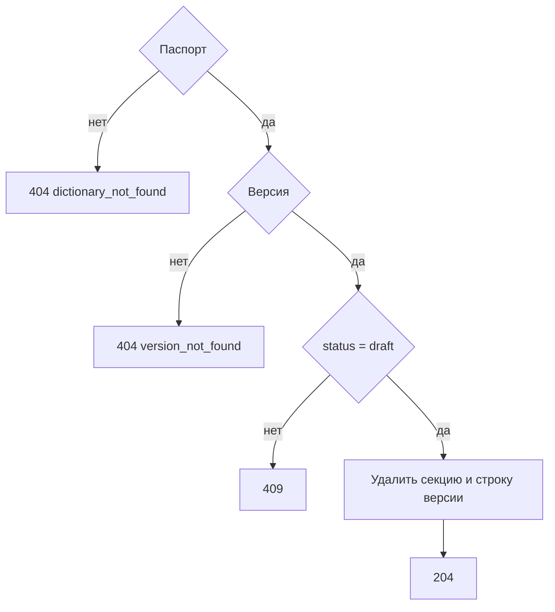

# [На главную](../../API.md)

# Описание

DELETE **/admin/dictionaries/{dictionary_code}/versions/{version_id}**
Удалить черновик: строку версии, секцию и строки данных. `active`, `closed` и `archived` этим вызовом не удаляются.

# Входные параметры

+ `dictionary_code`:
    + path
    + Обязательно
+ `version_id`:
    + path
    + Обязательно

Тела нет.

# Поля ответа

Тела нет.

# Алгоритм работы

1. Найти паспорт.
    + Нет:
        + Код: `dictionary_not_found`
        + Статус: `404`
2. Найти версию.
    + Нет:
        + Код: `version_not_found`
        + Статус: `404`
3. `status` не `draft`:
    + Статус: `409`
4. Удалить секцию `{table_name}_{version_id}` и строку `dictionary_version`.
5. Вернуть статус `204`. SQL-файлы в `db/sql-data` не удалять.

Удаляется только неопубликованный черновик. Номер версии повторно не выдаётся: следующий черновик получает `max(version_id) + 1`.
