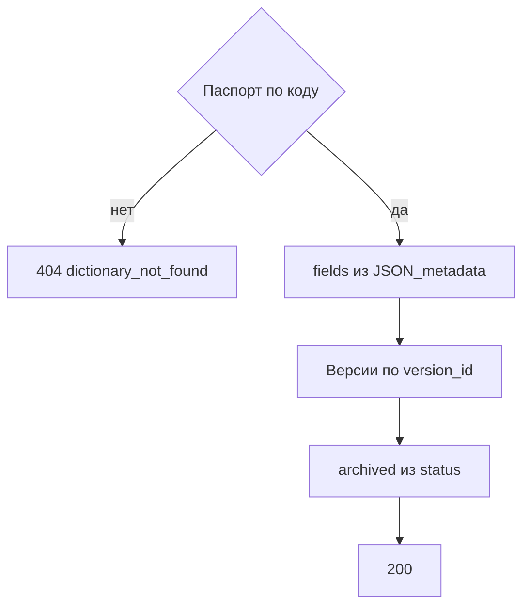

# [На главную](../../API.md)

# Описание

GET **/admin/passports/{dictionary_code}**
Паспорт, описание полей и версии справочника. Строк значений нет.

# Входные параметры

+ `dictionary_code`:
    + path
    + Обязательно

# Параметры ответа

+ `dictionary_id`
+ `dictionary_code`
+ `dictionary_name`
+ `owner` — может быть пустым
+ `source` — может быть пустым
+ `status`
+ `table_name`
+ `schema_name` — для простого списка пусто
+ `fields`:
    + Массив
    + `code`
    + `name`
    + `type`
    + `length`
    + `nullable`
+ `versions`:
    + Массив, по `version_id` по убыванию
    + `dictionary_version_id`
    + `version_id`
    + `status`
    + `valid_from`
    + `valid_to` — заполнен у `closed` и `archived`
    + `archived` — `true`, когда `status = archived`

# Алгоритм работы

1. Найти `dictionary` по коду без учёта регистра.
    + Нет строки:
        + Код: `dictionary_not_found`
        + Статус: `404`
2. Собрать `fields`, `table_name` и `schema_name` из `dictionary.JSON_metadata`.
3. Прочитать `dictionary_version` этого `dictionary_id`, сортировка `version_id` по убыванию.
4. Для каждой версии `archived = (status = archived)`.
5. Вернуть статус `200`. Секцию не читать.

`archived` берётся из записанного статуса версии. Строки секции не читаются.
