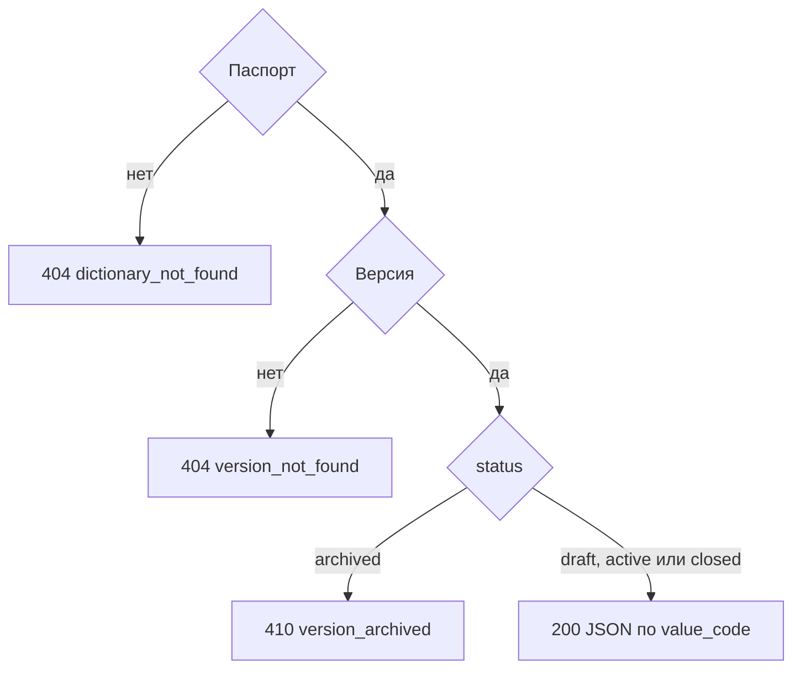

# [На главную](../../API.md)

# Описание

GET **/admin/dictionaries/{dictionary_code}/versions/{version_id}**
Отдать данные версии JSON-файлом: черновик, действующую или закрытую. У `archived` строк нет.

# Входные параметры

+ `dictionary_code`:
    + path
    + Обязательно
+ `version_id`:
    + path
    + Обязательно

# Параметры ответа

+ `Content-Type: application/json; charset=utf-8`
+ `Content-Disposition: attachment; filename="{dictionary_code}_v{version_id}.json"`
+ `dictionary_code`
+ `version_id`
+ `version_status`
+ `valid_from`
+ `valid_to`
+ `archived` — `true`, когда `status = archived`
+ `fields`
+ `rows`:
    + Массив, порядок по `value_code`
    + `value_code`
    + `name`
    + дополнительные поля строки

# Алгоритм работы

1. Найти паспорт.
    + Нет:
        + Код: `dictionary_not_found`
        + Статус: `404`
2. Найти `dictionary_version` по `dictionary_id` и `version_id`.
    + Нет строки:
        + Код: `version_not_found`
        + Статус: `404`
3. `status = archived`:
    + Код: `version_archived`
    + Статус: `410`
    + Строки не читать
4. Прочитать секцию `WHERE version_id = {version_id}` в порядке `value_code`. Черновик читается так же, как `active` и `closed`.
5. Вернуть статус `200`. Файл в `db/sql-data` не писать.

Черновик администратору отдаётся. `archived` в каталоге означает, что секция уже отсоединена и строк нет. Ответ — JSON в теле, файл в `db/sql-data` не создаётся.
