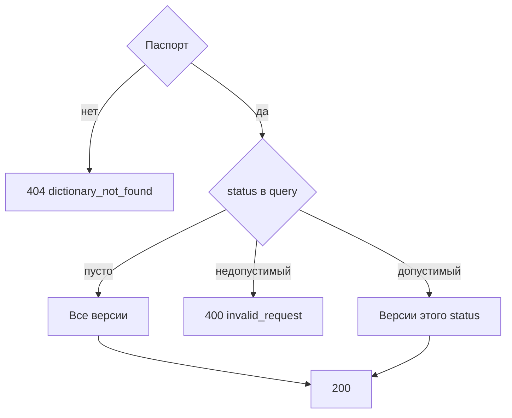

# [На главную](../../API.md)

# Описание

GET **/admin/dictionaries/{dictionary_code}/versions**
Список версий справочника. Строк значений нет. Фильтр передаётся параметром запроса.

# Входные параметры

+ `dictionary_code`:
    + path
    + Обязательно
+ `status`:
    + query
    + Не обязательно
    + `draft`, `active`, `closed` или `archived`
    + Без параметра возвращаются все версии

# Параметры ответа

+ `items`:
    + Массив, по `version_id` по убыванию
    + `dictionary_version_id`
    + `version_id`
    + `status`
    + `valid_from`
    + `valid_to`
    + `archived` — `true`, когда `status = archived`

# Алгоритм работы

1. Найти паспорт по коду без учёта регистра.
    + Нет строки:
        + Код: `dictionary_not_found`
        + Статус: `404`
2. Проверить `status`, если он передан.
    + Значение не из четырёх статусов:
        + Код: `invalid_request`
        + Статус: `400`
3. Прочитать `dictionary_version` этого `dictionary_id`. При переданном `status` оставить только его. Сортировка `version_id` по убыванию.
4. Для каждой строки `archived = (status = archived)`.
5. Вернуть статус `200`. Секции не читать.

Тела у `GET` нет. `archived` берётся из записанного статуса, а не из наличия секции.
