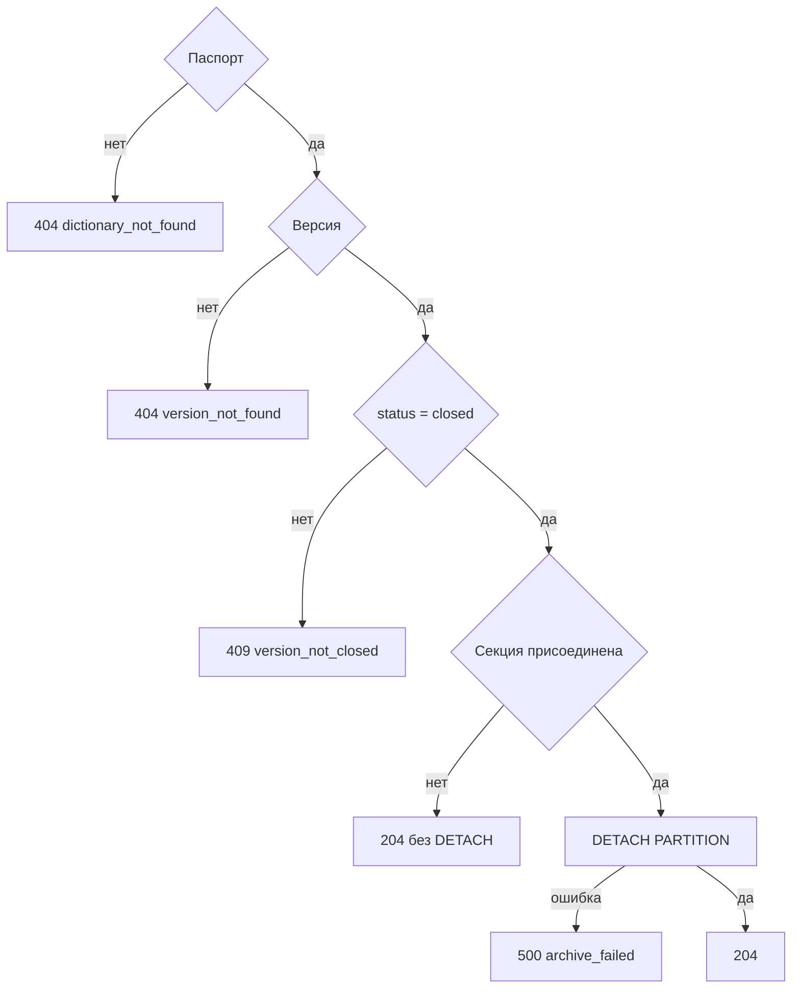

# [На главную](../../API.md)

# Описание

POST **/admin/dictionaries/{dictionary_code}/versions/{version_id}/archive**
Отсоединить секцию закрытой версии. Строка `dictionary_version` остаётся. Повтор уже архивированной версии возвращает `204`.

# Входные параметры

+ `dictionary_code`:
    + path
    + Обязательно
+ `version_id`:
    + path
    + Обязательно

Тела нет.

# Параметры ответа

Тела нет.

# Алгоритм работы

1. Найти паспорт.
    + Нет:
        + Код: `dictionary_not_found`
        + Статус: `404`
2. Найти версию.
    + Нет:
        + Код: `version_not_found`
        + Статус: `404`
3. `status` не `closed`:
    + Код: `version_not_closed`
    + Статус: `409`
4. Секция уже отсоединена — вернуть статус `204`. `DETACH` не выполнять.
5. Иначе выполнить `ALTER TABLE "{table_name}" DETACH PARTITION "{table_name}_{version_id}"`.
    + Ошибка выполнения:
        + Код: `archive_failed`
        + Статус: `500`
6. Вернуть статус `204`. Строку каталога не удалять и её `status` не менять. SQL-файлы не писать и не удалять.

Повтор уже архивированной версии снова даёт `204` и секцию не трогает. Строка `dictionary_version` остаётся со статусом `closed`.
