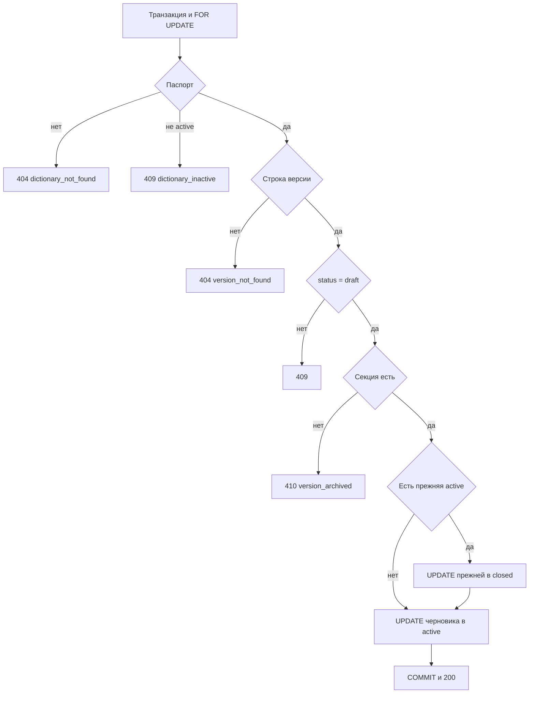

# [На главную](../../API.md)

# Описание

POST **/admin/dictionaries/{dictionary_code}/versions/{version_id}/publish**
Сделать черновик действующей версией и закрыть прежнюю действующую. Секцию и строки создаёт [загрузка](post_versions.md).

# Входные параметры

+ `dictionary_code`:
    + path
    + Обязательно
+ `version_id`:
    + path
    + Обязательно
    + Номер черновика

Тела нет.

# Параметры ответа

+ `version_id`
+ `status` = `active`
+ `valid_from`
+ `valid_to` — пусто
+ `closed_version_id` — пусто, если закрывать было нечего
+ `closed_valid_to` — пусто, если закрывать было нечего

# Алгоритм работы

1. Начать транзакцию. Заблокировать строку `dictionary` через `SELECT ... FOR UPDATE`.
2. Нет паспорта:
    + Код: `dictionary_not_found`
    + Статус: `404`
3. `status` паспорта не `active`:
    + Код: `dictionary_inactive`
    + Статус: `409`
4. Найти `dictionary_version` по `dictionary_id` и `version_id`.
    + Нет строки:
        + Код: `version_not_found`
        + Статус: `404`
5. `status` версии не `draft`:
    + Статус: `409`
    + Уже `active` и `closed` не публиковать
6. Секция `public.{table_name}_{version_id}` отсутствует:
    + Код: `version_archived`
    + Статус: `410`
    + Статус версии не менять
7. Если есть другая версия со `status = active`, закрыть её в этой транзакции:
    + `status = closed`
    + `valid_to = valid_from` публикуемого черновика минус 1 день
    + Её `version_id` — `closed_version_id`, вычисленная дата — `closed_valid_to`
    + Действующей нет — оба поля ответа пустые, закрывающий `UPDATE` не выполнять
8. Перевести черновик в `active`. `valid_from` не перезаписывать. `valid_to` остаётся пустым. Строки и секцию не менять.
9. Зафиксировать транзакцию. Вернуть статус `200`. Свой SQL-файл не создавать.

Закрытие прежней версии ставит `valid_to` на день раньше `valid_from` черновика. Смена статусов — `UPDATE` в этой транзакции, своего SQL-файла нет. Секцию и строки метод не переписывает.
