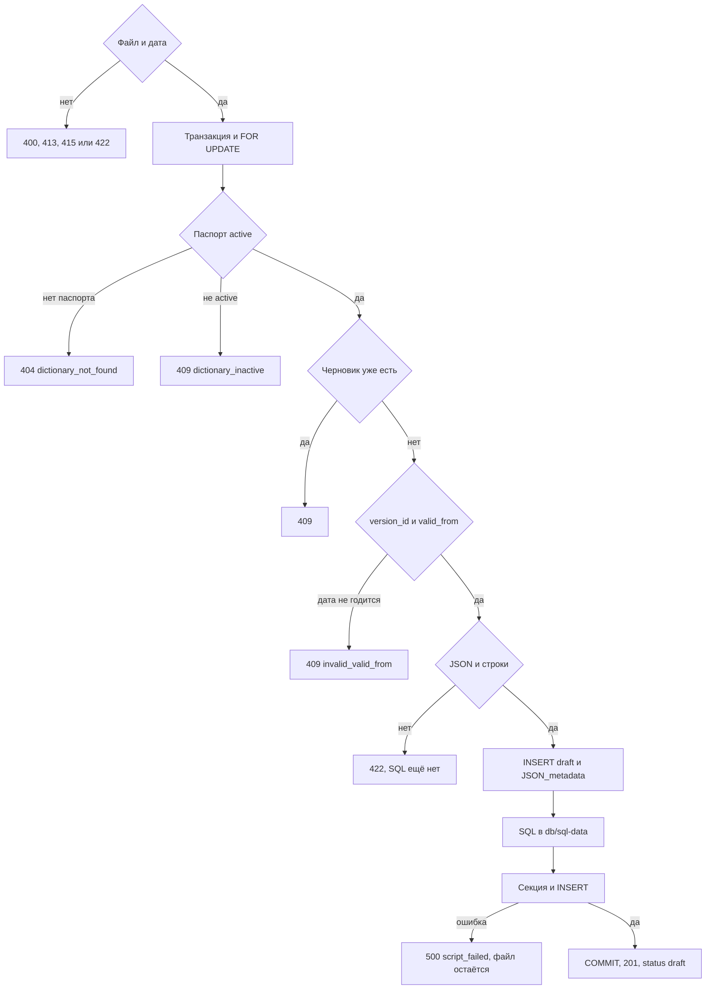

# [На главную](../../API.md)

# Описание

POST **/admin/dictionaries/{dictionary_code}/versions**
Принять файл строк и оставить версию черновиком. Публикация — [Опубликовать черновик](post_publish.md).

# Входные параметры

+ `dictionary_code`:
    + path
    + Обязательно
+ `file`:
    + form
    + Обязательно
    + CSV или JSON, не больше 100 МБ
    + CSV: UTF-8, первая строка — заголовок, разделитель `;` или `,`, кавычки `"`
    + JSON: массив объектов или объект с полем `rows`
    + Обязательные колонки: `value_code`, `name`
    + Остальные колонки совпадают с `fields`
    + Пустое значение допустимо только у nullable-поля
+ `valid_from`:
    + form
    + Обязательно
    + Дата `YYYY-MM-DD`

# Параметры ответа

+ `dictionary_version_id`
+ `version_id` — номер новой версии
+ `status` = `draft`
+ `valid_from` — дата из формы
+ `valid_to` — пусто
+ `row_count`
+ `data_sql_path`

# Алгоритм работы

1. Проверить файл до транзакции.
    + Нет поля `file` или `valid_from` не в виде `YYYY-MM-DD`:
        + Код: `invalid_request`
        + Статус: `400`
    + Файл больше 100 МБ:
        + Код: `file_too_large`
        + Статус: `413`
    + Не CSV и не JSON:
        + Код: `unsupported_media_type`
        + Статус: `415`
    + Файл пуст:
        + Код: `empty_file`
        + Статус: `422`
2. Начать транзакцию. Заблокировать строку `dictionary` через `SELECT ... FOR UPDATE`.
3. Нет паспорта:
    + Код: `dictionary_not_found`
    + Статус: `404`
4. `status` паспорта не `active`:
    + Код: `dictionary_inactive`
    + Статус: `409`
5. У справочника уже есть версия со `status = draft`:
    + Статус: `409`
    + SQL не писать
6. `version_id = max(version_id) + 1`. Версий нет — номер 1.
7. Если есть версия со `status = active`, `valid_from` новой строго позже её `valid_from`.
    + Иначе:
        + Код: `invalid_valid_from`
        + Статус: `409`
8. Разобрать файл в JSON в памяти. Путь файла не задан.
    + Файл пуст:
        + Код: `empty_file`
        + Статус: `422`
    + Файл не разобран:
        + Код: `invalid_file`
        + Статус: `422`
    + Колонка не из `fields`:
        + Код: `unknown_field`
        + Статус: `422`
    + Нет `value_code` или `name`:
        + Код: `missing_field`
        + Статус: `422`
    + Повтор `value_code`:
        + Код: `duplicate_value_code`
        + Статус: `422`
    + Тип, nullable или пустое у обязательного поля:
        + Код: `invalid_value`
        + Статус: `422`
    + До этих ошибок SQL не пишется
9. Вставить строку в `dictionary_version`:
    + `status = draft`
    + `valid_from` — дата из формы
    + `valid_to` пусто
    + копия `JSON_metadata` паспорта
    + `table_name` паспорта
    + `schema_name` пусто
    + Прежняя `active` не меняется
10. Записать SQL в `db/sql-data/{table_name}/{локальное время до секунды} - {table_name}.sql`.
    + Пример: `db/sql-data/wall_material/2026.10.23 16.10.00 - wall_material.sql`
    + UTF-8 без BOM. Если имя занято, добавить `-2`, `-3` и далее
    + Создание секции `{table_name}_{version_id}` как `PARTITION OF` для `FOR VALUES IN (version_id)`
    + `INSERT` строк пачками до 1000, порядок — порядок файла
    + `'` в строке удваивается, перевод строки заменяется пробелом
    + Дата — `DATE 'YYYY-MM-DD'`, пустое — `NULL`
    + `UPDATE` статусов в файл не входит
11. Выполнить файл в той же транзакции: секция, затем вставки.
    + Ошибка выполнения:
        + Код: `script_failed`
        + Статус: `500`
        + Транзакция откатывается, уже записанный SQL-файл остаётся
12. Зафиксировать транзакцию. Версия остаётся `draft`. Вернуть статус `201`, `data_sql_path` и `row_count`.

«JSON и строки» — разбор файла в память, путь на диск не задан. Снимок `JSON_metadata` — колонка `dictionary_version`. SQL в `db/sql-data` — секция и вставки, без смены статусов. После `COMMIT` версия остаётся `draft`, прежняя `active` не закрывается.
