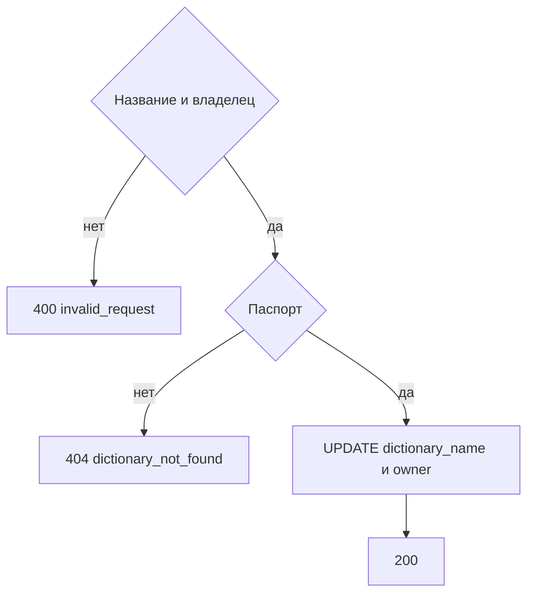

# [На главную](../../API.md)

# Описание

PATCH **/admin/passports/{dictionary_code}**
Изменить название и владельца паспорта. Код, поля и таблица данных не меняются.

# Входные параметры

+ `dictionary_code`:
    + path
    + Обязательно
+ `dictionary_name`:
    + body
    + Обязательно
    + От 1 до 200 символов
+ `owner`:
    + body
    + Не обязательно
    + До 200 символов. Пустое значение очищает владельца

# Параметры ответа

+ `dictionary_id`
+ `dictionary_code`
+ `dictionary_name`
+ `owner`
+ `status`

# Алгоритм работы

1. Проверить тело.
    + Нет `dictionary_name`, длина вне диапазона или неизвестное поле:
        + Код: `invalid_request`
        + Статус: `400`
2. Найти `dictionary` по коду без учёта регистра.
    + Нет строки:
        + Код: `dictionary_not_found`
        + Статус: `404`
3. Записать `dictionary_name` и `owner`. `dictionary_code`, `status` и `JSON_metadata` не менять.
4. Вернуть статус `200`.

Код справочника берётся из пути и остаётся прежним. Версии и секции этот вызов не трогает.
