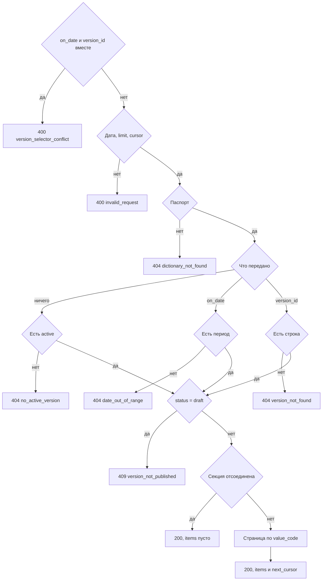

# [На главную](../../API.md)

# Описание

GET **/dictionaries/{dictionary_code}/values**
Страница строк выбранной редакции: `value_code` и `name`, порядок по `value_code`.

# Входные параметры

+ `dictionary_code`:
    + path
    + Обязательно
+ `on_date`:
    + query
    + Не обязательно
    + Дата `YYYY-MM-DD`
    + Вместе с `version_id` нельзя
+ `version_id`:
    + query
    + Не обязательно
    + Вместе с `on_date` нельзя
+ `limit`:
    + query
    + Не обязательно
    + integer, от 1 до 1000, по умолчанию 100
+ `cursor`:
    + query
    + Не обязательно
    + Последний `value_code` предыдущей страницы
    + С курсором передаётся тот же выбор редакции, что у первой страницы

# Параметры ответа

+ `dictionary_code`
+ `version_id`
+ `version_status`
+ `valid_from`
+ `valid_to`
+ `archived`
+ `items`:
    + Массив
    + `value_code`
    + `name`
+ `next_cursor` — последний `value_code` страницы или пусто

Пустая версия — `items` пустой. Архивированная — `archived: true` и `items` пустой.

# Алгоритм работы

1. Проверить селектор редакции и страницу.
    + Переданы и `on_date`, и `version_id`:
        + Код: `version_selector_conflict`
        + Статус: `400`
    + `limit` вне 1…1000, дата не в виде `YYYY-MM-DD` или `cursor` не разбирается:
        + Код: `invalid_request`
        + Статус: `400`
2. Найти паспорт по коду без учёта регистра.
    + Нет:
        + Код: `dictionary_not_found`
        + Статус: `404`
    + `inactive` чтению не мешает
3. Выбрать редакцию.
    + Ничего не передано — версия со `status = active`. Нет такой:
        + Код: `no_active_version`
        + Статус: `404`
    + Передан `on_date` — версия, где `valid_from <= дата` и (`valid_to` пуст или `valid_to >= дата`). Несколько строк — больший `version_id`. Нет периода:
        + Код: `date_out_of_range`
        + Статус: `404`
    + Передан `version_id` — эта версия. Нет строки:
        + Код: `version_not_found`
        + Статус: `404`
    + Выбранная версия в `draft`:
        + Код: `version_not_published`
        + Статус: `409`
4. Секция отсоединена — вернуть статус `200`, `archived: true`, `items` пустой. Таблицу не читать.
5. Выбрать строки секции: `version_id` равен выбранному, при курсоре `value_code` больше курсора, сортировка по `value_code`, предел `limit`.
6. Вернуть статус `200`. Ноль строк — пустой `items`. Если продолжать нечего, `next_cursor` пустой.

Редакция выбирается так же, как у одного значения. Курсор — последний `value_code` предыдущей страницы той же редакции. Отсоединённая секция отдаёт пустой `items` и `archived: true`.
