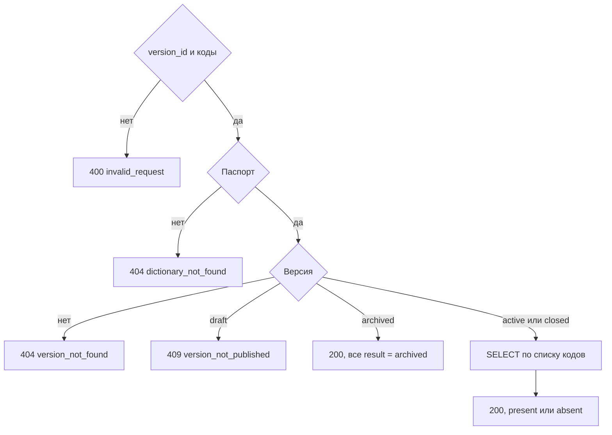

# [На главную](../../API.md)

# Описание

POST **/dictionaries/{dictionary_code}/values/check**
Проверить коды в секции указанной версии. Ничего не записывает. Выбор по дате не делается.

# Входные параметры

+ `dictionary_code`:
    + path
    + Обязательно
+ `version_id`:
    + body
    + Обязательно
+ `value_codes`:
    + body
    + Обязательно
    + От 1 до 1000 кодов
    + Повтор в запросе в ответе один раз

# Параметры ответа

+ `dictionary_code`
+ `version_id`
+ `version_status`
+ `valid_from`
+ `valid_to`
+ `archived`
+ `items`:
    + Массив в порядке запрошенных кодов
    + `value_code`
    + `result` — `present`, `absent` или `archived`
    + `name` — пусто при `absent` и `archived`

Если версия архивирована, у всех кодов `result = archived`.

# Алгоритм работы

1. Проверить тело.
    + Нет `version_id`, кодов не от 1 до 1000, неизвестное поле или тело не разобрано:
        + Код: `invalid_request`
        + Статус: `400`
    + Повторы `value_codes` свернуть к одному коду
2. Найти паспорт.
    + Нет:
        + Код: `dictionary_not_found`
        + Статус: `404`
3. Найти версию по номеру.
    + Нет строки:
        + Код: `version_not_found`
        + Статус: `404`
    + `status = draft`:
        + Код: `version_not_published`
        + Статус: `409`
    + `status = archived` — вернуть статус `200`, `archived: true`, у каждого кода `result = archived` и пустой `name`. Таблицу не читать
4. Выбрать из секции `value_code`, `name`, где `version_id` равен запрошенному и код входит в список.
    + Найден — `present`
    + Не найден — `absent`, `name` пусто
5. Вернуть статус `200`. В БД и файлы не писать.

Дата здесь не выбирает редакцию: секция берётся по `version_id` из тела. Повторы кодов в ответе схлопываются в один. Статус `archived` не ошибка: у всех кодов `result = archived`.
