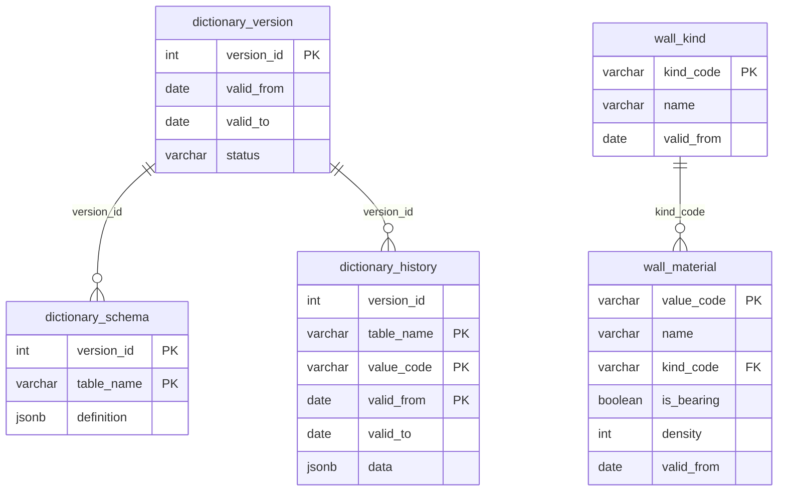

# История без копии всего справочника

Живые таблицы держат только текущее состояние: типизированные колонки и обычный внешний ключ. У строки есть `valid_from` — день, с которого действует это состояние. Каталог редакций хранит номер и период. Форма каждой таблицы редакции лежит одной строкой в `dictionary_schema`. В `dictionary_history` попадает строка, которую заменили или удалили. Строка, которая не менялась, лежит один раз в живой таблице.

Черновик в эти таблицы не пишется. При публикации в живые таблицы попадает только отличие от текущего состояния, а вытесненное состояние дописывается в историю.

Пример ниже — справочник из двух таблиц. 20.10.2026 у кирпича сменилось имя, появился металл и у материала добавилось поле `kind_code` со ссылкой на вид. Камень, дерево и брус в историю не записываются.

# Изменение схемы

Схема редакции — это набор таблиц, колонок и внешних ключей на её периоде. От редакции к редакции допустимо любое из этого:

- новая таблица, удаление таблицы
- новый внешний ключ, удаление внешнего ключа
- новая колонка, удаление, переименование, смена типа и обязательности

Живые таблицы всегда в форме последней опубликованной редакции. Прошлая форма таблицы записана документом в `dictionary_schema`: колонки, первичный ключ и внешние ключи, в том числе составные.

Малая публикация — новая редакция того же справочника. Так одни и те же перестройки накапливаются за годы: за один выпуск меняется немного, через пять лет справочник может прийти к другому набору таблиц. Выпуск, в котором справочник заменяется целиком — за один раз удаляется большая часть таблиц и заново собираются оставшиеся, — идёт как новый справочник.

Объём истории ограничивается удалением ранних редакций. Вместе с редакцией уходят её схема и документы истории, чей период закончился раньше первой оставшейся редакции. Даты удалённых редакций больше не читаются. Живые таблицы остаются как есть.

Публикация применяет отличие к живым таблицам:

- Новая таблица создаётся пустой, её строки получают `valid_from` новой редакции. В старых схемах этой таблицы нет.
- Удаляемая таблица: текущее состояние каждой её строки закрывается в историю, затем таблица удаляется. Дата старой схемы читает её только из истории.
- Новые колонка и внешний ключ появляются в живой таблице. Старая схема их не показывает, и строки из-за этого не копируются. Ключ ставится, когда колонка уже заполнена.
- Удаление колонки, смена типа, при которой прежнее значение не прочитать, удаление ключа вместе с колонкой: прежнее состояние строки пишется в историю.
- Переименование колонки записывается полем `column` у колонки в документе. Живая колонка одна, старое имя читается из неё.
- Удаление внешнего ключа без удаления колонки снимает ограничение. Старая схема по-прежнему находит соседа по коду и дате.

# Схема

Строка `dictionary_schema` есть у каждой таблицы, которая входила в редакцию. `definition.columns[].column` — физическая колонка живой таблицы. Пока имя не менялось, оно совпадает с `name`. Составной внешний ключ — один элемент `foreign_keys` со списками колонок.

Связь `kind_code` в живых таблицах есть с редакции 2. У документа в истории внешнего ключа нет: сосед ищется по коду и дате, и только если эта связь записана в `definition` запрошенной редакции.

# Содержимое

`dictionary_version`

| version_id | valid_from | valid_to | status |
| --- | --- | --- | --- |
| 1 | 2024-01-01 | 2026-10-19 | closed |
| 2 | 2026-10-20 | | active |

`dictionary_schema`

| version_id | table_name | definition |
| --- | --- | --- |
| 1 | wall_kind | `{"columns":[{"name":"kind_code","column":"kind_code","type":"string","nullable":false},{"name":"name","column":"name","type":"string","nullable":false}],"primary_key":["kind_code"],"foreign_keys":[]}` |
| 1 | wall_material | `{"columns":[{"name":"value_code","column":"value_code","type":"string","nullable":false},{"name":"name","column":"name","type":"string","nullable":false},{"name":"is_bearing","column":"is_bearing","type":"boolean","nullable":false},{"name":"density","column":"density","type":"int","nullable":false}],"primary_key":["value_code"],"foreign_keys":[]}` |
| 2 | wall_kind | `{"columns":[{"name":"kind_code","column":"kind_code","type":"string","nullable":false},{"name":"name","column":"name","type":"string","nullable":false}],"primary_key":["kind_code"],"foreign_keys":[]}` |
| 2 | wall_material | `{"columns":[{"name":"value_code","column":"value_code","type":"string","nullable":false},{"name":"name","column":"name","type":"string","nullable":false},{"name":"kind_code","column":"kind_code","type":"string","nullable":false},{"name":"is_bearing","column":"is_bearing","type":"boolean","nullable":false},{"name":"density","column":"density","type":"int","nullable":false}],"primary_key":["value_code"],"foreign_keys":[{"columns":["kind_code"],"ref_table":"wall_kind","ref_columns":["kind_code"]}]}` |

У редакции 1 в документе материала нет ни колонки `kind_code`, ни внешнего ключа. У редакции 2 ключ — один элемент `foreign_keys`, даже когда колонок в нём несколько.

`wall_kind`

| kind_code | name | valid_from |
| --- | --- | --- |
| STONE | Камень | 2024-01-01 |
| WOOD | Дерево | 2024-01-01 |
| METAL | Металл | 2026-10-20 |

`wall_material`

| value_code | name | kind_code | is_bearing | density | valid_from |
| --- | --- | --- | --- | --- | --- |
| BRICK | Кирпич керамический | STONE | да | 1800 | 2026-10-20 |
| TIMBER | Брус | WOOD | нет | 500 | 2024-01-01 |
| STEEL | Сталь | METAL | да | 7850 | 2026-10-20 |

`dictionary_history`

| version_id | table_name | value_code | valid_from | valid_to | data |
| --- | --- | --- | --- | --- | --- |
| 1 | wall_material | BRICK | 2024-01-01 | 2026-10-19 | `{"value_code":"BRICK","name":"Кирпич","is_bearing":true,"density":1800}` |

# Выборка на дату

Вход: имя таблицы и дата.

1. Найти редакцию в `dictionary_version`: `valid_from` не позже даты, `valid_to` пустой или не раньше даты. Нет такой редакции — на эту дату справочника нет. Ранняя редакция, удалённая вместе со своими документами схемы, сюда тоже не попадает.
2. Взять строку `dictionary_schema` этой редакции и запрошенной таблицы. Строки нет — на эту дату таблицы не было, ответ пустой. Список полей ответа — `definition.columns`.
3. Из `dictionary_history` взять строки этой таблицы, у которых `valid_from` не позже даты и `valid_to` не раньше даты. Значение поля берётся из `data` по `name`.
4. Если живая таблица ещё есть, взять из неё строки, у которых `valid_from` не позже даты и код не попал в шаг 3. Значение поля берётся из колонки `column`. Колонки, которой нет в `definition.columns`, в ответ не входят. Живой таблицы уже нет — в ответе только шаг 3.
5. Ответ — строки шагов 3 и 4. Сосед по внешнему ключу ищется этим же алгоритмом на ту же дату, и только когда связь есть в `definition.foreign_keys` этой строки.

Удалённый код остаётся только в истории и попадает в ответ, пока дата внутри его интервала. Код, появившийся позже даты, в живой таблице имеет более поздний `valid_from` и в ответ не входит.

На 2024-06-01 редакция 1. Кирпич закрыт в истории. Брус берётся из живой строки, `kind_code` в документе этой редакции нет и в ответ не входит. Сталь и металл начинаются 2026-10-20.

`wall_kind` на 2024-06-01

| kind_code | name |
| --- | --- |
| STONE | Камень |
| WOOD | Дерево |

`wall_material` на 2024-06-01

| value_code | name | is_bearing | density |
| --- | --- | --- | --- |
| BRICK | Кирпич | да | 1800 |
| TIMBER | Брус | нет | 500 |

На 2026-10-20 редакция 2. Интервал кирпича в истории уже закрыт, все три материала и все три вида берутся из живых таблиц.

`wall_kind` на 2026-10-20

| kind_code | name |
| --- | --- |
| STONE | Камень |
| WOOD | Дерево |
| METAL | Металл |

`wall_material` на 2026-10-20

| value_code | name | kind_code | is_bearing | density |
| --- | --- | --- | --- | --- |
| BRICK | Кирпич керамический | STONE | да | 1800 |
| TIMBER | Брус | WOOD | нет | 500 |
| STEEL | Сталь | METAL | да | 7850 |
