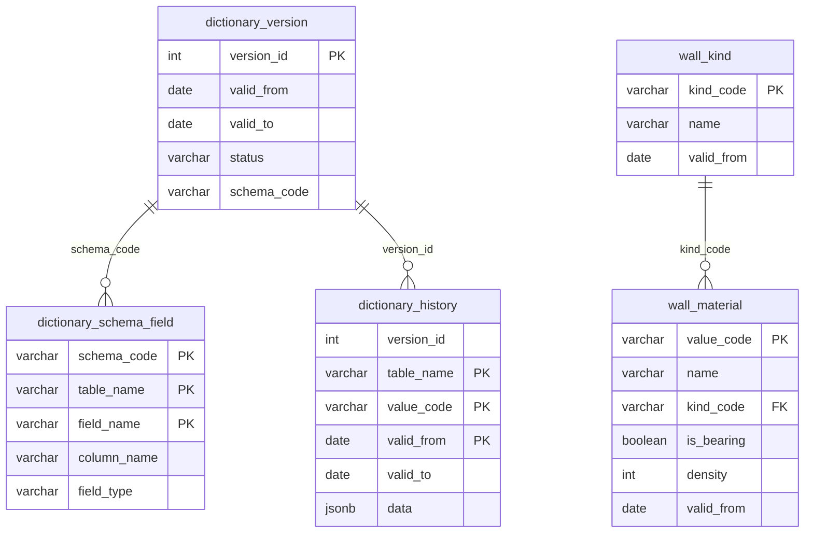

# История без копии всего справочника

Живые таблицы держат только текущее состояние: типизированные колонки и обычный внешний ключ. У строки есть `valid_from` — день, с которого действует это состояние. Каталог редакций хранит номер, период и код схемы. В `dictionary_history` попадает строка, которую заменили или удалили. Строка, которая не менялась, лежит один раз в живой таблице.

Черновик в эти таблицы не пишется. При публикации в живые таблицы попадает только отличие от текущего состояния, а вытесненное состояние дописывается в историю.

Пример ниже — справочник из двух таблиц. 20.10.2026 у кирпича сменилось имя, появился металл и у материала добавилось поле `kind_code`. Камень, дерево и брус в историю не записываются.

# Схема

`column_name` — колонка живой таблицы, из которой читается поле. Пока поле не переименовывали, оно совпадает с `field_name`. После переименования старая схема смотрит на новую колонку, и строку из-за этого копировать не нужно.

Связь `kind_code` действует между живыми таблицами. У документа в истории внешнего ключа нет: сосед ищется по коду и дате.

# Содержимое

`dictionary_version`

| version_id | valid_from | valid_to | status | schema_code |
| --- | --- | --- | --- | --- |
| 1 | 2024-01-01 | 2026-10-19 | closed | schema_1 |
| 2 | 2026-10-20 | | active | schema_2 |

`dictionary_schema_field`

| schema_code | table_name | field_name | column_name | field_type |
| --- | --- | --- | --- | --- |
| schema_1 | wall_kind | kind_code | kind_code | string |
| schema_1 | wall_kind | name | name | string |
| schema_1 | wall_material | value_code | value_code | string |
| schema_1 | wall_material | name | name | string |
| schema_1 | wall_material | is_bearing | is_bearing | boolean |
| schema_1 | wall_material | density | density | int |
| schema_2 | wall_kind | kind_code | kind_code | string |
| schema_2 | wall_kind | name | name | string |
| schema_2 | wall_material | value_code | value_code | string |
| schema_2 | wall_material | name | name | string |
| schema_2 | wall_material | kind_code | kind_code | string |
| schema_2 | wall_material | is_bearing | is_bearing | boolean |
| schema_2 | wall_material | density | density | int |

`wall_kind`

| kind_code | name | valid_from |
| --- | --- | --- |
| STONE | Камень | 2024-01-01 |
| WOOD | Дерево | 2024-01-01 |
| METAL | Металл | 2026-10-20 |

`wall_material`

| value_code | name | kind_code | is_bearing | density | valid_from |
| --- | --- | --- | --- | --- | --- |
| BRICK | Кирпич керамический | STONE | да | 1800 | 2026-10-20 |
| TIMBER | Брус | WOOD | нет | 500 | 2024-01-01 |
| STEEL | Сталь | METAL | да | 7850 | 2026-10-20 |

`dictionary_history`

| version_id | table_name | value_code | valid_from | valid_to | data |
| --- | --- | --- | --- | --- | --- |
| 1 | wall_material | BRICK | 2024-01-01 | 2026-10-19 | `{"value_code":"BRICK","name":"Кирпич","is_bearing":true,"density":1800}` |

# Выборка на дату

Вход: имя таблицы и дата.

1. Найти редакцию в `dictionary_version`: `valid_from` не позже даты, `valid_to` пустой или не раньше даты. Нет такой редакции — на эту дату справочника нет.
2. Взять `schema_code` этой редакции и строки `dictionary_schema_field` для этой схемы и запрошенной таблицы. Это список полей ответа.
3. Из `dictionary_history` взять строки этой таблицы, у которых `valid_from` не позже даты и `valid_to` не раньше даты. Значение поля берётся из `data` по `field_name`.
4. Из живой таблицы взять строки, у которых `valid_from` не позже даты и код не попал в шаг 3. Значение поля берётся из колонки `column_name`. Колонка, которой нет в списке полей, в ответ не входит.
5. Ответ — строки шага 3 и шага 4.

Удалённый код остаётся только в истории и попадает в ответ, пока дата внутри его интервала. Код, появившийся позже даты, в живой таблице имеет более поздний `valid_from` и в ответ не входит.

На 2024-06-01 редакция 1, схема `schema_1`. Кирпич закрыт в истории. Брус берётся из живой строки, `kind_code` в схеме 1 нет и в ответ не входит. Сталь и металл начинаются 2026-10-20.

`wall_kind` на 2024-06-01

| kind_code | name |
| --- | --- |
| STONE | Камень |
| WOOD | Дерево |

`wall_material` на 2024-06-01

| value_code | name | is_bearing | density |
| --- | --- | --- | --- |
| BRICK | Кирпич | да | 1800 |
| TIMBER | Брус | нет | 500 |

На 2026-10-20 редакция 2, схема `schema_2`. Интервал кирпича в истории уже закрыт, все три материала и все три вида берутся из живых таблиц.

`wall_kind` на 2026-10-20

| kind_code | name |
| --- | --- |
| STONE | Камень |
| WOOD | Дерево |
| METAL | Металл |

`wall_material` на 2026-10-20

| value_code | name | kind_code | is_bearing | density |
| --- | --- | --- | --- | --- |
| BRICK | Кирпич керамический | STONE | да | 1800 |
| TIMBER | Брус | WOOD | нет | 500 |
| STEEL | Сталь | METAL | да | 7850 |
